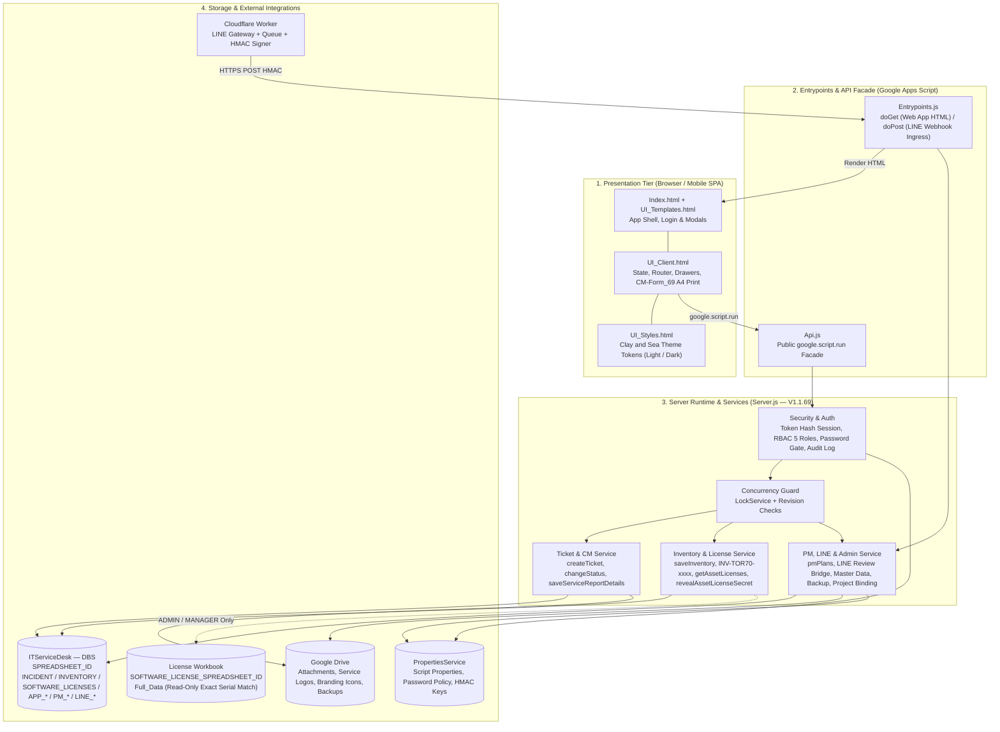
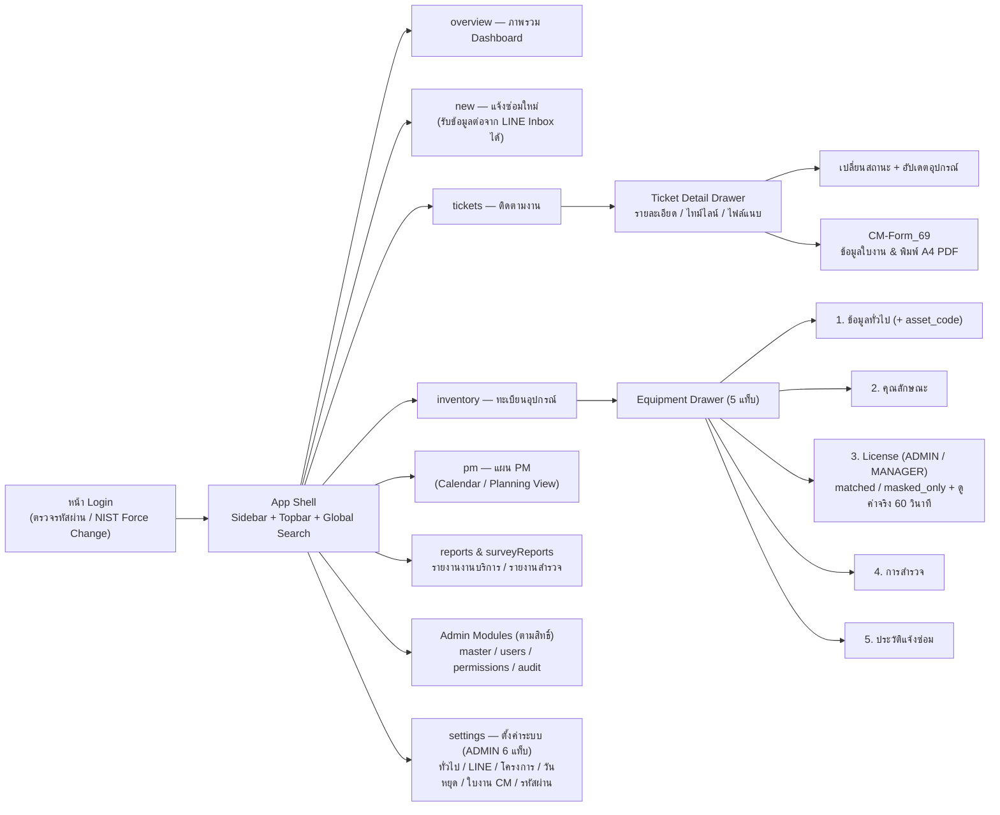
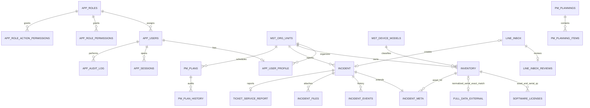

# Web App Diagram, Data Diagram และ Data Dictionary

เอกสารนี้อธิบายทั้ง **สถาปัตยกรรม Web App (Diagram WebApp)**, **แผนผังหน้าจอการนำทาง (UI Navigation Map)** และ **โครงสร้างฐานข้อมูล Google Sheets (Data Diagram & Dictionary)**

> ระบบใช้ Google Sheets เป็นฐานข้อมูลแบบตาราง ความสัมพันธ์ด้านล่างเป็น **logical relationship** ที่ `Server.js` ดูแล ไม่ใช่ foreign key ที่ Google Sheets บังคับโดยอัตโนมัติ ผู้ดูแลจึงต้องรักษา ID และ reference เดิม

## 1. Web App Architecture Diagram

## 2. Web App Screen & Navigation Map (`UI_Client.html`)

## 3. ภาพรวมความสัมพันธ์ข้อมูลหลัก (`erDiagram`)

## 4. กลุ่มตาราง (Data Dictionary)

### Ticket และไฟล์

| Sheet | Key / reference | หน้าที่ |
|---|---|---|
| `INCIDENT` | `เลขที่แจ้งปัญหา` | ข้อมูลคำขอ ผู้แจ้ง อุปกรณ์ หน่วยงาน สถานะ ผู้ดำเนินการและผลแก้ไข |
| `INCIDENT_META` | `ticket_id` → `INCIDENT` | asset, assignee, confirmation, close/reopen metadata |
| `INCIDENT_EVENTS` | `event_id`, `ticket_id` | timeline การเปลี่ยนสถานะและหมายเหตุ |
| `INCIDENT_FILES` | `file_id`, `ticket_id` | metadata ของไฟล์ใน Google Drive |
| `TICKET_SERVICE_REPORT` | `ticket_id` | ผลงานบริการ (`CM-Form_69`) อุปกรณ์ส่งซ่อม/ทดแทน และ revision |

### ครุภัณฑ์และข้อมูลหลัก

| Sheet | Key / reference | หน้าที่ |
|---|---|---|
| `INVENTORY` | `รหัสอุปกรณ์` (`INV-TOR70-xxxx`) | ข้อมูลทั่วไป เทคนิค (`หมายเลขสินทรัพย์`) สถานที่ สถานะ และผลสำรวจ |
| `SOFTWARE_LICENSES` (ใน DBS) | `รหัส License`, `รหัสอุปกรณ์` → `INVENTORY` | ทะเบียน License แบบปกปิด (`Product Key_Masked`, `Account_Email_Masked`), สถานะตรวจสอบ และ QC notes (ไม่เก็บคีย์/รหัสผ่านดิบ) |
| `Full_Data` (External License Workbook) | `Serial Number Notebook` → `INVENTORY.หมายเลขซีเรียล` | Product Key และบัญชีติดตั้งต้นฉบับ; เฉพาะ `ADMIN`/`MANAGER` อ่านตามคำขอ ไม่รวมใน bootstrap และไม่เก็บค่าจริงใน Audit Log |
| `MST_DEVICE_MODELS` | `model_id` | master ประเภทอุปกรณ์ ยี่ห้อ และรุ่น |
| `MST_ORG_UNITS` | `org_unit_id` | โครงสร้างหน่วยงาน ชื่อย่อ ระดับ และสถานที่ |
| `APP_LOOKUPS` | `lookup_id`, `lookup_type` | รายการเลือก เช่น ประเภทปัญหา/สถานะ/ช่องทาง |

### ผู้ใช้ สิทธิ์ และระบบ

| Sheet | Key / reference | หน้าที่ |
|---|---|---|
| `APP_USERS` | `user_id`, `username` | บัญชี hash/salt, role (`ADMIN`, `MANAGER`, `TECHNICIAN`, `ITSUPPORT`, `USER`), lock และสถานะใช้งาน |
| `APP_USER_PROFILE` | `profile_id`, `user_id` | โปรไฟล์ หน่วยงาน ติดต่อ และรูป |
| `APP_SESSIONS` | `token_hash`, `user_id` | session expiry/revocation; ไม่เก็บ raw token |
| `APP_ROLES` | `role_id`, `role_code` | นิยาม Role |
| `APP_ROLE_PERMISSIONS` | `permission_id`, `role_code` | สิทธิ์ระดับ module/CRUD/export/manage (11 modules) |
| `APP_ROLE_ACTION_PERMISSIONS` | `permission_id`, `role_key`, `action_key` | สิทธิ์ action แบบละเอียดและ scope |
| `APP_SETTINGS` | `key` | branding, folder ID, policy, `CM-Form_69` template และ binding marker |
| `APP_AUDIT_LOG` | `audit_id` | ผู้ทำ action, entity, result, detail และ session reference |

### LINE และ PM

| Sheet | Key / reference | หน้าที่ |
|---|---|---|
| `LINE_INBOX` | `inbox_id`, `event_id` | envelope ที่รับจาก Gateway และสถานะ review/create |
| `LINE_INBOX_REVIEWS` | `inbox_id` | ข้อมูลที่ผู้ตรวจแก้ก่อนสร้าง ticket พร้อม revision |
| `PM_PLANNINGS` | `planning_id` | กลุ่มแผนและช่วงเวลา |
| `PM_PLANNING_ITEMS` | `plan_id`, `planning_id` | งานในกลุ่มแผน ผู้รับผิดชอบ priority/progress |
| `PM_PLANS` | `plan_id` | งาน PM ตามวัน หน่วยงาน พื้นที่ เวลา และสถานะ |
| `PM_PLAN_HISTORY` | `log_id`, `plan_id` | before/after JSON และผู้ดำเนินการ |
| `APP_HOLIDAYS` | `id` | วันหยุด/กิจกรรม ช่วงวันที่ revision และ soft delete |

## 5. Referential integrity ที่ต้องรักษา

1. `ticket_id` ใน meta/event/file/report ต้องอ้างถึง ticket เดิม
2. `drive_file_id` ต้องไม่ถูกลบจาก Drive ขณะยังมี `INCIDENT_FILES` อ้างถึง
3. `user_id`, `role_code`, `org_unit_id`, `model_id` ต้องใช้ค่าจาก master ที่เกี่ยวข้อง
4. การ deactivate ปลอดภัยกว่าการลบ master ที่มีการอ้างอิง
5. Bulk import ต้องตรวจ header, preview, validation และจำนวนไม่เกิน 500 แถวต่อคำขอ
6. ห้าม renumber, fuzzy merge หรือ auto-map ข้อมูลที่มี history โดยไม่มี mapping report และการอนุมัติ
7. การจับคู่ `License/Full_Data` ต้องเป็น normalized exact serial ที่มีหนึ่งแถวต่อหนึ่งอุปกรณ์เท่านั้น; หาก Serial ซ้ำหรือไม่พบ ระบบจะ fallback เป็น `masked_only` จาก `SOFTWARE_LICENSES` บน DBS หรือแจ้งสถานะให้ Admin ตรวจสอบด้วยคน
8. `License` Workbook (`1ZiBug...`) ต้องไม่เปิด Public sharing และ credential ที่เคยเปิดเผยต้องถูกเปลี่ยน

## 6. การสำรอง

สำรองทั้ง Spreadsheet (`ITServiceDesk — DBS` และ `License`) และไฟล์ Drive ที่เกี่ยวข้อง บันทึก source commit, Apps Script version, deployment ID, เวลา และผู้ดำเนินการ การสำรอง source ด้วย `clasp pull` ไม่ใช่การสำรองข้อมูล Sheets หรือ Script Properties
