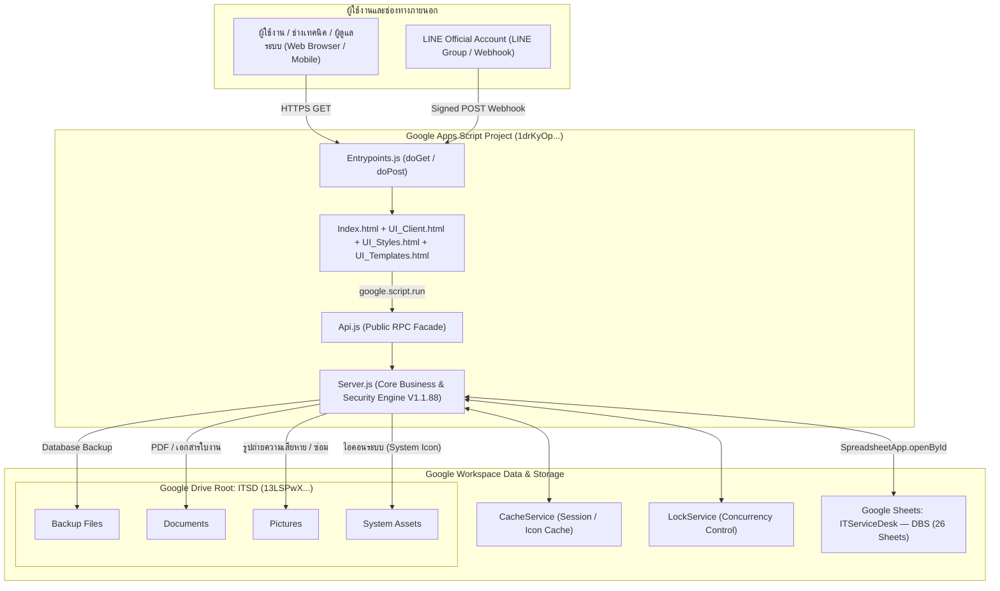
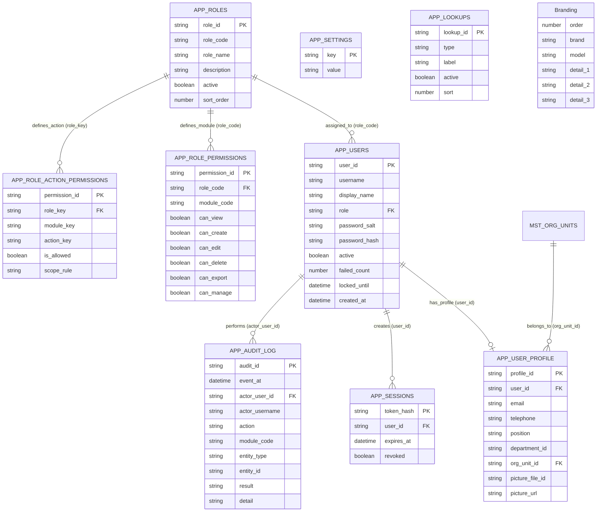
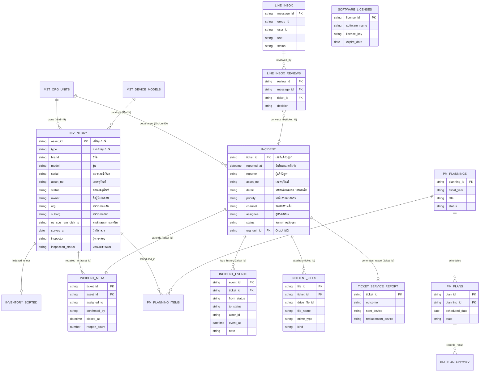
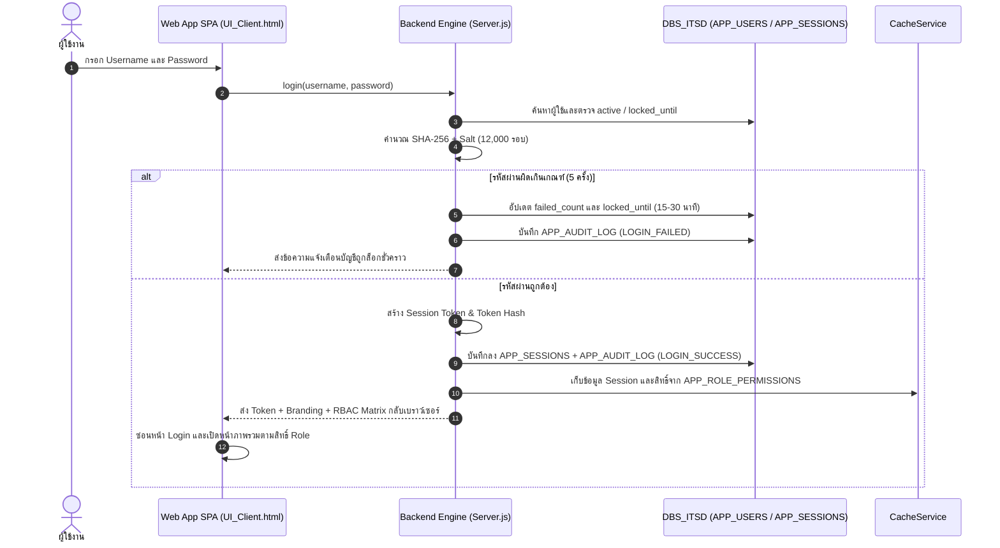
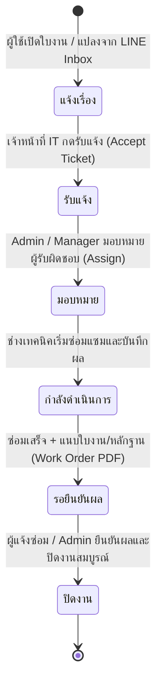
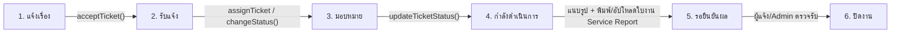
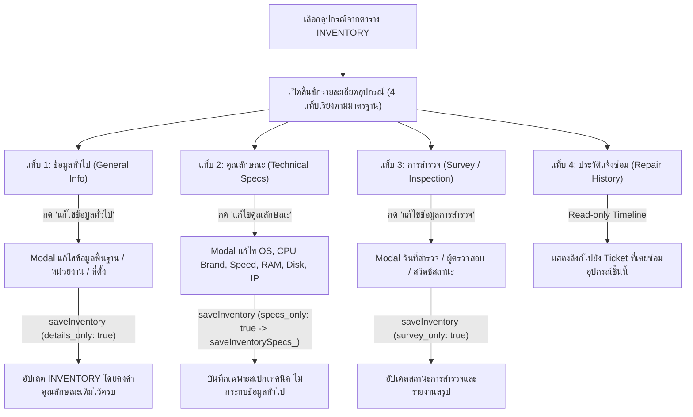
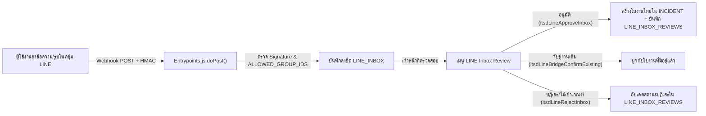
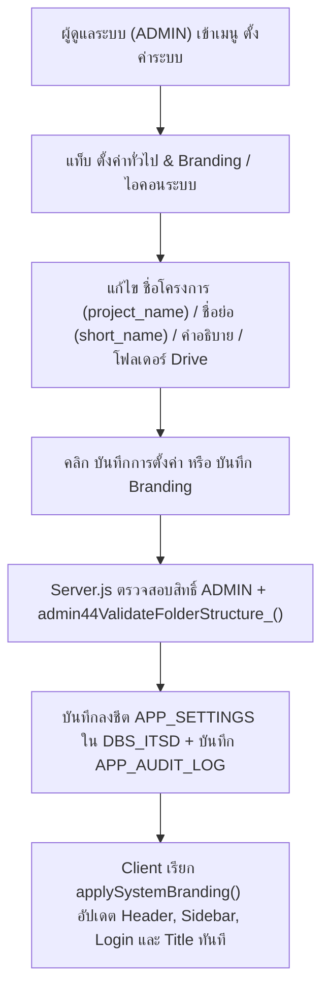

# 🗂️ Data Diagram & System Workflows
### ITSD : ITServiceDesk (ระบบแจ้งซ่อมออนไลน์ และการจัดการครุภัณฑ์ไอที)
**Version: ITSD V1.1.88 | Create by : LongZe Design**

เอกสารนี้อธิบายโครงสร้างความสัมพันธ์ของฐานข้อมูล (**Entity Relationship Diagram — 26 ตารางใน `DBS_ITSD`**), โครงสร้างการจัดเก็บไฟล์บน **Google Drive**, สถาปัตยกรรมระบบ (**System Architecture**) และผังกระบวนการทำงานหลัก (**Workflows**) ทั้งหมดของระบบ **ITSD : ITServiceDesk**

---

## 📌 ข้อมูลอ้างอิงโครงสร้างโปรเจกต์ (Unified Project Links)

| องค์ประกอบ | รหัสอ้างอิง (ID) | ลิงก์เข้าถึง |
| :--- | :--- | :--- |
| **GitHub Repository** | `thakot-cloud/ITServiceDesk` | https://github.com/thakot-cloud/ITServiceDesk |
| **Upstream Repository** | `longzedesign-dotcom/ITServiceDesk` | https://github.com/longzedesign-dotcom/ITServiceDesk |
| **Google Drive Root (`ITSD`)** | `13LSPwXw4tEkw-F4wGJO9Q2qbn9RZx5Oe` | https://drive.google.com/drive/folders/13LSPwXw4tEkw-F4wGJO9Q2qbn9RZx5Oe |
| **Google Sheets (`ITServiceDesk — DBS`)** | `1i-yE0Lg2gILkLENEpk8t1Q9OSVlGpOoximunZwbxF4c` | https://docs.google.com/spreadsheets/d/1i-yE0Lg2gILkLENEpk8t1Q9OSVlGpOoximunZwbxF4c/edit |
| **Apps Script Editor** | `1drKyOpXXRBkf9s9uFXZi6h3PoSy1Ud-SfqMkx8xPyDNNl1XWxcGiVUF7` | https://script.google.com/home/projects/1drKyOpXXRBkf9s9uFXZi6h3PoSy1Ud-SfqMkx8xPyDNNl1XWxcGiVUF7/edit |
| **Web App Production URL** | `AKfycbxPnpvvQqmD5FrkHhLIqEdGsX-mCpV5R57G5SrTVPNQ87zxViX_4ObmRvsL0fayTps` (`@144` / V1.1.88) | https://script.google.com/macros/s/AKfycbxPnpvvQqmD5FrkHhLIqEdGsX-mCpV5R57G5SrTVPNQ87zxViX_4ObmRvsL0fayTps/exec |

---

## 1. สถาปัตยกรรมระบบและการเชื่อมต่อ (System Architecture & Drive Mapping)

---

## 2. Data Diagram — โครงสร้างความสัมพันธ์ฐานข้อมูล (ER Diagram — 26 ตาราง)

### 2.1 กลุ่มผู้ใช้งาน สิทธิ์ การตั้งค่า และความปลอดภัย (Identity, RBAC, Settings & Audit)

### 2.2 กลุ่มทะเบียนครุภัณฑ์ ใบงานแจ้งซ่อม แผนบำรุงรักษา PM และ LINE Integration

---

## 3. System Workflows — ผังกระบวนการทำงานของระบบ

### 3.1 การยืนยันตัวตนและการตรวจสอบสิทธิ์ (Authentication & RBAC Session Flow)

### 3.2 วงจรสถานะใบงานแจ้งซ่อม 6 ขั้นตอน (6-Stage Ticket Lifecycle Workflow)

### 3.3 การจัดการทะเบียนครุภัณฑ์แบบแยกแท็บ 4 ส่วน (Modular 4-Tab Equipment Workflow)

### 3.4 กระบวนการรับแจ้งซ่อมผ่าน LINE Messaging API (LINE Inbox Review Workflow)

### 3.5 กระบวนการตั้งค่าชื่อโครงการ Branding และ Google Drive โดย ADMIN

---

  ITSD : ITServiceDesk (ระบบแจ้งซ่อมออนไลน์ และการจัดการครุภัณฑ์ไอที) — Version V1.1.88 | Create by : LongZe Design © 2026

