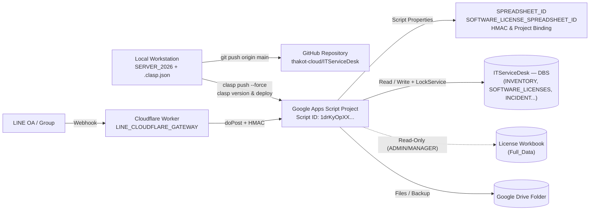

# คู่มือการติดตั้ง พัฒนา เผยแพร่ และคำแนะนำ IT Service Desk

เอกสารนี้เป็นคู่มือฉบับสมบูรณ์และ runbook สำหรับผู้ดูแลระบบและผู้พัฒนา ครอบคลุมทั้ง **การอัปเดต Production ปัจจุบัน (`V1.1.69`)**, **การติดตั้งโครงการใหม่ตั้งแต่ต้น**, **การเชื่อมต่อ LINE Cloudflare Gateway** และ **คำแนะนำเชิงปฏิบัติ/ความปลอดภัย**

## 1. ข้อมูลอ้างอิงของโครงการ (Production ปัจจุบัน)

| รายการ | ค่าที่ต้องตรง |
|---|---|
| ชื่อโครงการ | `IT Service Desk : ระบบแจ้งซ่อม บริหารจัดการงานครุภัณฑ์` |
| Release ปัจจุบัน | `V1.1.69` (Apps Script Version `120`) |
| Local path | `/Users/chaloem/Apps_Script/ITSD_CLASP_STAGING/SERVER_2026` |
| Drive folder | `13LSPwXw4tEkw-F4wGJO9Q2qbn9RZx5Oe` |
| Main Database (`ITServiceDesk — DBS`) | `1i-yE0Lg2gILkLENEpk8t1Q9OSVlGpOoximunZwbxF4c` |
| License Workbook (`Full_Data`) | `1ZiBugthGA-lD8KTAqntK6ckboTLlqoU61X-FpBdEIL4` |
| Apps Script ID | `1drKyOpXXRBkf9s9uFXZi6h3PoSy1Ud-SfqMkx8xPyDNNl1XWxcGiVUF7` |
| Deployment ID (คงที่) | `AKfycbxPnpvvQqmD5FrkHhLIqEdGsX-mCpV5R57G5SrTVPNQ87zxViX_4ObmRvsL0fayTps` |
| GitHub | `https://github.com/thakot-cloud/ITServiceDesk` |

ลิงก์: [Drive](https://drive.google.com/drive/folders/13LSPwXw4tEkw-F4wGJO9Q2qbn9RZx5Oe) · [Database (DBS)](https://docs.google.com/spreadsheets/d/1i-yE0Lg2gILkLENEpk8t1Q9OSVlGpOoximunZwbxF4c/edit?gid=1859184703#gid=1859184703) · [License Workbook](https://docs.google.com/spreadsheets/d/1ZiBugthGA-lD8KTAqntK6ckboTLlqoU61X-FpBdEIL4/edit?gid=1597152238#gid=1597152238) · [Source editor](https://script.google.com/home/projects/1drKyOpXXRBkf9s9uFXZi6h3PoSy1Ud-SfqMkx8xPyDNNl1XWxcGiVUF7/edit) · [Production Web App](https://script.google.com/macros/s/AKfycbxPnpvvQqmD5FrkHhLIqEdGsX-mCpV5R57G5SrTVPNQ87zxViX_4ObmRvsL0fayTps/exec)

## 2. แผนผังโครงสร้างการติดตั้งและเผยแพร่ (Deployment Topology)



## 3. สิ่งที่ต้องมีและสิทธิ์

- macOS/Linux shell, Git, Node.js LTS (แนะนำ v20+ สำหรับ `node --test`) และ `@google/clasp`
- สิทธิ์ Editor ของ Apps Script, Main Spreadsheet (`ITServiceDesk — DBS`) และ Drive folder
- สิทธิ์อย่างน้อย **Viewer (อ่าน)** บนไฟล์ `License` (`1ZiBug...`) สำหรับบัญชีเจ้าของ Deployment
- สิทธิ์ push repository `thakot-cloud/ITServiceDesk`
- บัญชี `ADMIN` ของระบบสำหรับทดสอบหลังเผยแพร่

ติดตั้ง clasp และเข้าสู่ระบบ:

```bash
npm install -g @google/clasp
clasp login
```

## 3. Clone หรือเชื่อม Local checkout

สำหรับเครื่องใหม่:

```bash
git clone https://github.com/thakot-cloud/ITServiceDesk.git /Users/chaloem/Apps_Script/ITSD_CLASP_STAGING/SERVER_2026
cd /Users/chaloem/Apps_Script/ITSD_CLASP_STAGING/SERVER_2026
```

สร้าง `.clasp.json` แบบ local-only:

```json
{
  "scriptId": "1drKyOpXXRBkf9s9uFXZi6h3PoSy1Ud-SfqMkx8xPyDNNl1XWxcGiVUF7"
}
```

ไฟล์ `.clasp.json`, `.claspignore`, backup และ report เฉพาะเครื่องถูกกันออกจาก Git แล้ว

## 4. ตรวจ identity ก่อนแตะ source

```bash
pwd
git status --short --branch
git remote -v
cat .clasp.json
clasp list-deployments
```

เงื่อนไขผ่าน:

1. `pwd` ตรง Local path ในข้อ 1
2. Git remote ชี้ `https://github.com/thakot-cloud/ITServiceDesk.git`
3. Script ID ตรง Apps Script ID ที่ยืนยัน
4. รายการ deployment มี Production Deployment ID เดิม
5. worktree ไม่มีไฟล์ที่ไม่ทราบที่มา; ถ้ามีให้ตรวจและเก็บงานก่อน

## 5. สำรองก่อน `clasp pull`

`clasp pull` สามารถเขียนทับไฟล์ local ได้ ต้องคัดลอกไฟล์ Apps Script ทั้งหมดไปโฟลเดอร์ timestamp ภายใต้ `.pull-backups/` และบันทึก checksum ก่อนทุกครั้ง

ไฟล์หลักที่ต้องสำรอง:

```text
Api.js
Entrypoints.js
Index.html
Server.js
UI_Client.html
UI_Styles.html
UI_Templates.html
appsscript.json
```

จากนั้นจึงรัน:

```bash
clasp pull
git diff --check
git diff --stat
```

สำคัญ: `clasp pull` ดึงเฉพาะ source/manifest ไม่ได้ดึง Script Properties, deployment configuration, ข้อมูล Sheets หรือไฟล์ใน Drive จึงยังสรุป runtime parity จาก source อย่างเดียวไม่ได้

## 6. Script Properties (Apps Script Project Settings)

ตั้งค่าที่ **Apps Script → Project Settings → Script Properties**:

| Property | ค่า/ความหมาย |
|---|---|
| `SPREADSHEET_ID` | `1i-yE0Lg2gILkLENEpk8t1Q9OSVlGpOoximunZwbxF4c` (ฐานข้อมูลหลัก DBS) |
| `SOFTWARE_LICENSE_SPREADSHEET_ID` | `1ZiBugthGA-lD8KTAqntK6ckboTLlqoU61X-FpBdEIL4` (ไฟล์ต้นฉบับ License; ปิด Public sharing) |
| `SOFTWARE_LICENSE_SHEET_NAME` | `Full_Data` (ค่าเริ่มต้นของ `V1.1.69`; รองรับ fallback `SOFTWARE_LICENSES`) |
| `INVENTORY_ID_PREFIX` | คำนำหน้ารหัสอุปกรณ์ (ค่าเริ่มต้นระบบคือ `INV-TOR70`) |
| `ITSD_TIMEZONE` | `Asia/Bangkok` |
| `ITSD_PROJECT_ID` | รหัสโครงการภาษาอังกฤษ เช่น `ocpb-itsd-production` |
| `ITSD_ENVIRONMENT` | `PRODUCTION` |
| `ITSD_DEPLOYMENT_URL` | URL `/exec` ของ Production Deployment |
| `LINE_MESSAGING_ENABLED` | `true` หรือ `false` สำหรับเปิดรับ LINE Inbox |
| `ALLOWED_GROUP_IDS` | รายการ LINE Group ID ที่อนุญาต (ต้องตรงกับฝั่ง Worker) |
| `ITSD_LINE_GATEWAY_HMAC_KEY` | กุญแจ HMAC (ความยาว ≥ 32 ตัวอักษร; ต้องตรงกับฝั่ง Worker) |
| `ITSD_GATEWAY_URL` | URL ของ Cloudflare Worker (เช่น `https://<worker>.workers.dev`) |
| `ITSD_WORKER_NAME` | ชื่อ Worker ใน `wrangler.jsonc` |
| `ITSD_BRIDGE_KEY` | Legacy bridge secret เฉพาะกรณีที่ยังใช้งาน |

สำหรับ **การติดตั้งโครงการใหม่ตั้งแต่ต้น** (New Spreadsheet + New Apps Script Project) ต้องตั้งค่าเพิ่มเติมชั่วคราวก่อนรัน `project70Bootstrap_()` คือ:
`ITSD_SETUP_PROJECT_NAME`, `ITSD_SETUP_ADMIN_USERNAME` (เช่น `ADMIN`), `ITSD_SETUP_ADMIN_NAME`, `ITSD_SETUP_ADMIN_PASSWORD` (อย่างน้อย 12 ตัวอักษร)

ห้ามคัดลอกค่า secret ลง source, เอกสาร, issue, log หรือ GitHub และห้ามบันทึกค่าจริงในภาพหน้าจอ

## 7. การติดตั้งโครงการใหม่ตั้งแต่ต้น และโครงสร้างข้อมูล

1. สร้าง Google Spreadsheet ว่างและ Apps Script Project ใหม่แยกต่อโครงการ (ห้ามใช้ฐาน Production เดิมในการทดลอง)
2. นำ source ทั้ง 8 ไฟล์ไปใส่ในโปรเจกต์ Apps Script (`clasp push --force`)
3. ตั้งค่า Script Properties ตามข้อ 6 (รวม `SPREADSHEET_ID` ของไฟล์ใหม่และ `ITSD_SETUP_*`)
4. ใน Apps Script Editor รันฟังก์ชัน **`project70Bootstrap_()`** 1 ครั้ง แล้วตรวจ log ว่าได้ `installed: true`
5. กด **Deploy → New deployment → Web App** (Execute as: `Me`, Who has access: `Anyone`) แล้วคัดลอก `/exec` URL
6. เข้าสู่ระบบด้วยบัญชี `ADMIN` ไปที่เมนู **ตั้งค่าระบบ → โครงการ / การเชื่อมต่อ** เพื่อสร้างโฟลเดอร์ Google Drive อัตโนมัติ (Root, Backups, Documents, Pictures, System Assets)
7. หากใช้งาน LINE Gateway ให้ตั้ง secrets บน Cloudflare Worker แยกต่อโครงการ:
   ```bash
   npx wrangler secret put LINE_CHANNEL_SECRET --name <worker-name>
   npx wrangler secret put ITSD_LINE_GATEWAY_HMAC_KEY --name <worker-name>
   npx wrangler secret put APP_SCRIPT_URL --name <worker-name>
   npx wrangler secret put ALLOWED_GROUP_IDS --name <worker-name>
   ```
   และกำหนด Webhook URL เป็น `<worker-url>/webhook/line` ใน LINE Developers Console

> โครงสร้างตารางทั้งหมดดูที่ [DATA_DIAGRAM.md](DATA_DIAGRAM.md) ห้ามเรียก installer ซ้ำหรือ bulk import เกิน 500 แถวต่อคำขอใส่ Production

## 8. มาตรฐานการพัฒนา

1. Pull และสร้าง commit checkpoint ของ source ฝั่ง Apps Script ก่อนเริ่มแก้
2. เพิ่มเลข patch version และ change history ในไฟล์ release ที่เกี่ยวข้อง (`PATCH_NOTES.md`, `Server.js`, `Api.js`, `Entrypoints.js`, `Index.html`, `UI_Client.html`)
3. รักษา backward compatibility ของ public function ใน `Api.js`
4. Validate input และตรวจ permission ฝั่ง server ทุก mutation; ห้ามพึ่ง UI guard อย่างเดียว
5. ใช้ `LockService` กับงานที่อาจเขียนชนกัน และ batch read/write Google Sheets เมื่อทำได้
6. ห้าม hard-code credential หรือข้อมูลส่วนบุคคล
7. ไม่ลบ/renumber/merge ticket, asset หรือ history ที่มี reference โดยไม่มีอนุมัติและ mapping report
8. แก้เฉพาะขอบเขตงานและแยก commit source กับเอกสาร

## 9. Validation และ Unit Tests ก่อน commit

```bash
git diff --check
node --check Server.js
node --check Api.js
node --check Entrypoints.js
node --test tests/next-inventory-id.test.js tests/license-matching.test.js
```

ตรวจ JavaScript ภายใน `UI_Client.html` โดยแยกเนื้อหาระหว่าง `<script>` และ `</script>` ไปยังไฟล์ชั่วคราว แล้วรัน `node --check` ตรวจต่อ:

- ไม่มี Script/Spreadsheet ID ชุดอื่นปะปน
- ไม่มี secret/token/password/private key
- `appsscript.json` เป็น `V8`, timezone `Asia/Bangkok`
- ฟังก์ชัน mutation และ maintenance ตรวจ permission ฝั่ง server
- UI ที่แก้รองรับ desktop/mobile และ light/dark ตามขอบเขตงาน

## 10. Commit และ Push GitHub

```bash
git fetch origin main
git status --short --branch
git add <เฉพาะไฟล์ที่ตรวจแล้ว>
git commit -m "docs: complete manuals, recommendations, and architecture diagrams"
git push origin main
```

หาก remote มี commit ใหม่ ให้รวมประวัติอย่างปลอดภัยและตรวจ conflict ห้าม `git push --force` ไป `main` และห้าม commit `.clasp.json`, backup หรือ secret

## 11. Push และ Deploy Apps Script

ขั้นตอนนี้ทำเมื่อได้รับอนุมัติ deploy:

```bash
clasp list-deployments
clasp push --force
clasp version "V1.1.69: Integrated License lookup, DBS SOFTWARE_LICENSES enrichment, and asset_code support"
clasp deploy --deploymentId AKfycbxPnpvvQqmD5FrkHhLIqEdGsX-mCpV5R57G5SrTVPNQ87zxViX_4ObmRvsL0fayTps --versionNumber 120 -d "V1.1.69: License integration & DBS sync"
clasp list-versions
clasp list-deployments
```

ต้องใช้ deployment ID เดิมเสมอ (`--deploymentId ...`) และระบุ `--versionNumber` ที่สร้างขึ้นใหม่ เพื่อคง Production URL `/exec` ห้าม `clasp deploy` โดยไม่ระบุ `--deploymentId` เพราะจะสร้าง deployment ใหม่

## 12. ตรวจหลัง Deploy

1. Production `/exec` ตอบ HTTP `200` และเปิดหน้า Login ได้
2. เวอร์ชันบน UI/Bootstrap (`publicSystemBranding`) ตรง release (`V1.1.69`)
3. Login/logout, NIST password policy และ session expiration ทำงาน
4. เปิด ticket, เปลี่ยนสถานะ, ประวัติ, ไฟล์แนบ และใบงาน `CM-Form_69` A4 PDF ทำงานครบ
5. ค้นหา/แก้ไขครุภัณฑ์ (`INV-TOR70-xxxx`, `asset_code`), แท็บ `License` (`ADMIN`/`MANAGER` only) และหน้าสำรวจโหลดได้
6. Dashboard/report ตรงข้อมูลทดสอบและ permission
7. ADMIN settings, audit log และ backup ใช้ token/permission ถูกต้อง
8. ถ้าใช้ LINE ให้ตรวจ signature, inbox review และการสร้าง ticket
9. ตรวจ Apps Script Executions ว่าไม่มี error ใหม่

## 13. คำแนะนำสำคัญ (Recommendations & Best Practices)

1. **ปิด Public Sharing ของไฟล์ `License` (`1ZiBug...`)**: ปรับสิทธิ์แชร์จาก "Anyone with the link" เป็น "Restricted" ให้เฉพาะบัญชีเจ้าของ Deployment และผู้รับผิดชอบที่จำเป็นอ่านเท่านั้น
2. **Rotate Credentials ที่เคยเปิดเผย**: หากเคยเปิดแชร์ไฟล์ `License` แบบสาธารณะ ให้พิจารณาเปลี่ยนรหัสผ่านบัญชีติดตั้ง (`oc***@outlook.com`) หรือคีย์ที่สำคัญ
3. **แก้ไข Serial Number 8 รายการใน `License/Full_Data`**: เพื่อเปลี่ยนจากโหมด `masked_only` ให้เปิดดูค่าจริง (`matched`) ได้ครบทั้ง 95 เครื่องโดยสมบูรณ์
4. **ตั้งค่า Script Property ชัดเจน**: กำหนด `SOFTWARE_LICENSE_SPREADSHEET_ID` และ `SOFTWARE_LICENSE_SHEET_NAME` (`Full_Data`) ใน Script Properties เสมอ ไม่พึ่งเพียง fallback ในโค้ด
5. **แยก GitHub กับ Apps Script ในใจเสมอ**: `git push origin main` เป็นการอัปเดตคลังโค้ดเท่านั้น ไม่เปลี่ยนหน้าเว็บจริงจนกว่าจะ `clasp push` และ `clasp deploy`
6. **ทำ DB Backup ก่อน Bulk Change**: ใช้เมนู **สำรองข้อมูล** หรือสำเนา Google Sheets ใน Drive ก่อน Import, ล้างข้อมูล หรือปรับปรุง Schema ทุกครั้ง

## 14. Rollback

- Source: revert ด้วย commit ใหม่ ห้าม reset/force-push ประวัติ `main`
- Runtime: เลือก Apps Script version ที่ผ่านการตรวจ (เช่น `@119`) แล้วอัปเดต deployment ID เดิมกลับไป version นั้น (`clasp deploy --deploymentId ... --versionNumber 119`)
- Data: กู้จาก backup หลังอนุมัติเท่านั้น ทดสอบกับสำเนาก่อน และรักษา ID/reference เดิม
- บันทึกเหตุผล ผู้อนุมัติ เวลา commit/version/deployment และผลตรวจหลัง rollback

## 15. Troubleshooting

| อาการ | วิธีตรวจ |
|---|---|
| `The caller does not have permission` | `clasp login` ใหม่ด้วยบัญชีที่มีสิทธิ์ Apps Script |
| `Requested entity was not found` | ตรวจ Script ID และสิทธิ์บัญชี ไม่เปลี่ยน `.clasp.json` แบบเดาสุ่ม |
| แท็บ `License` ขึ้น `masked_only` หรือเข้าถึงไฟล์ต้นทางไม่ได้ | ตรวจสิทธิ์ Viewer ของบัญชีเจ้าของ Deployment บนไฟล์ `1ZiBug...` และค่า `SOFTWARE_LICENSE_SPREADSHEET_ID` / `SOFTWARE_LICENSE_SHEET_NAME=Full_Data` |
| Web App ยังเป็นรุ่นเก่า | ตรวจ `clasp list-deployments` ว่าชี้ที่ version ล่าสุดหรือไม่ และลองเปิดใน Incognito/Private Window |
| เปิดได้แต่ข้อมูลผิดไฟล์ | ตรวจ Script Property `SPREADSHEET_ID` และ project identity ทันที หยุด mutation จนกว่าจะยืนยัน |
| GitHub 401/403 | ตรวจบัญชี/credential ของ Git และสิทธิ์ repository; ห้ามแก้ด้วย force push |

## 16. Release checklist

- [ ] ยืนยัน Local, Git remote, Script ID, Spreadsheet ID, Deployment ID
- [ ] สำรอง source และข้อมูลก่อน pull/migration
- [ ] Pull แล้วตรวจ diff
- [ ] เพิ่ม patch version และ change history
- [ ] Syntax checks (`node --check`) + UI `<script>` check + `node --test` ผ่านครบ
- [ ] ฐาน `License` ปิด Public sharing, credential ที่เคยเปิดเผยถูกเปลี่ยน และผู้ Deploy อ่านไฟล์ได้
- [ ] คู่มือ คำแนะนำ และ diagram อัปเดตตรง source
- [ ] Commits แยกชัดเจนและ `git push origin main` สำเร็จ
- [ ] ได้รับอนุมัติ Apps Script push/deploy
- [ ] ใช้ deployment ID เดิมและตรวจ Production `/exec` ตอบ HTTP 200
- [ ] บันทึกผลทดสอบและ rollback point
