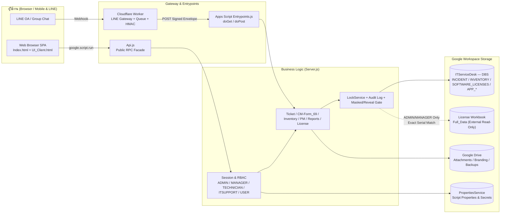

# IT Service Desk : ระบบแจ้งซ่อม บริหารจัดการงานครุภัณฑ์

Google Apps Script Web App สำหรับรับแจ้งและติดตามงานบริการไอที จัดการครุภัณฑ์ สำรวจอุปกรณ์ วางแผนบำรุงรักษา จัดการสิทธิ์ ออกรายงาน สำรองข้อมูล และรับรายการจาก LINE Gateway โดยใช้ Google Sheets เป็นฐานข้อมูลหลัก

## Production ที่ยืนยันแล้ว

| รายการ | ค่า |
|---|---|
| Release ปัจจุบัน | `V1.1.69` (Apps Script Version `120`) |
| Local checkout | `/Users/chaloem/Apps_Script/ITSD_CLASP_STAGING/SERVER_2026` |
| Google Drive folder | [เปิดโฟลเดอร์โครงการ](https://drive.google.com/drive/folders/13LSPwXw4tEkw-F4wGJO9Q2qbn9RZx5Oe) |
| Database หลัก (`ITServiceDesk — DBS`) | [เปิด Google Sheets](https://docs.google.com/spreadsheets/d/1i-yE0Lg2gILkLENEpk8t1Q9OSVlGpOoximunZwbxF4c/edit?gid=1859184703#gid=1859184703) (`INVENTORY`, `SOFTWARE_LICENSES`, `INCIDENT`, `PM_*`, `APP_*`) |
| License ต้นฉบับ (`License` / `Full_Data`) | [เปิด License Workbook](https://docs.google.com/spreadsheets/d/1ZiBugthGA-lD8KTAqntK6ckboTLlqoU61X-FpBdEIL4/edit?gid=1597152238#gid=1597152238) |
| Apps Script source | [เปิด Apps Script editor](https://script.google.com/home/projects/1drKyOpXXRBkf9s9uFXZi6h3PoSy1Ud-SfqMkx8xPyDNNl1XWxcGiVUF7/edit) |
| Deployment ID (คงที่) | `AKfycbxPnpvvQqmD5FrkHhLIqEdGsX-mCpV5R57G5SrTVPNQ87zxViX_4ObmRvsL0fayTps` |
| Production Web App | [เปิด Web App](https://script.google.com/macros/s/AKfycbxPnpvvQqmD5FrkHhLIqEdGsX-mCpV5R57G5SrTVPNQ87zxViX_4ObmRvsL0fayTps/exec) |
| GitHub | [thakot-cloud/ITServiceDesk](https://github.com/thakot-cloud/ITServiceDesk) |

ก่อน `clasp pull`, `clasp push` หรือ deploy ต้องตรวจว่า `.clasp.json` ใช้ Script ID ข้างต้น และ `SPREADSHEET_ID` / `SOFTWARE_LICENSE_SPREADSHEET_ID` ใน Script Properties ชี้ตรงกับโครงการเสมอ

## สถาปัตยกรรม Web App ภาพรวม



## ความสามารถหลัก

- **Ticket Workflow & CM-Form_69**: แจ้งเรื่อง → รับแจ้ง → มอบหมาย → กำลังดำเนินการ → รอยืนยันผล → ปิดงาน พร้อมพิมพ์ใบงานบริการ A4 (`CM-Form_69`) ลงนามและแนบหลักฐาน
- **Inventory & Survey (`INV-TOR70-xxxx`)**: ทะเบียนครุภัณฑ์ รหัสอุปกรณ์เรียงลำดับ ช่อง `หมายเลขสินทรัพย์` (`asset_code`) คุณลักษณะทางเทคนิค สถานที่ การสำรวจ และประวัติแจ้งซ่อม
- **Software License Integration (`V1.1.69`)**: แท็บ `License` สำหรับ `ADMIN` และ `MANAGER` ผสานสถานะจาก `SOFTWARE_LICENSES` บน DBS กับคีย์จริงจาก `License/Full_Data` (รองรับโหมด `masked_only`) พร้อมยืนยันรหัสผ่านเพื่อดูค่าจริง 60 วินาทีและบันทึก Audit Log
- **Dashboard & Reports**: รายงานงานบริการ รายงานสำรวจ (แบ่งสถานะ **ยังไม่สำรวจ** / **สำรวจเรียบร้อย**) และ Export ตามสิทธิ์
- **RBAC & Governance**: จัดการผู้ใช้ Role (`ADMIN`, `MANAGER`, `TECHNICIAN`, `ITSUPPORT`, `USER`), Permission Matrix ระดับ module และ action พร้อม Audit Log
- **LINE Inbox Bridge**: รับ envelope จาก LINE Gateway ผ่าน HMAC เข้าคิว `LINE_INBOX` เพื่อตรวจสอบ อนุมัติ และส่งข้อมูลเข้าสู่ฟอร์มแจ้งซ่อม
- **PM Calendar & Planning**: แผนบำรุงรักษาเชิงป้องกัน มุมมองปฏิทิน/Planning และวันหยุดราชการ (`APP_HOLIDAYS`)
- **System Backup & Project Binding**: สำรองฐานข้อมูล ตั้งค่า Branding/Drive/Password Policy/LINE และการสร้างโครงการใหม่

## โครงสร้าง source

| ไฟล์ | หน้าที่ |
|---|---|
| `Server.js` | business logic, repository, validation, security และ service ฝั่ง Apps Script |
| `Api.js` | public compatibility facade ที่ browser/maintenance เรียกใช้ |
| `Entrypoints.js` | `doGet`/`doPost` และ entry points |
| `Index.html` | Web App shell |
| `UI_Client.html` | browser controllers และ client-side behavior |
| `UI_Styles.html` | styles และ design tokens |
| `UI_Templates.html` | reusable templates |
| `appsscript.json` | runtime (`V8`), timezone (`Asia/Bangkok`), scopes และ Web App configuration |
| `tests/*.test.js` | unit tests ฝั่ง Node.js (ไม่ถูก push ขึ้น Apps Script ตาม `.claspignore`) |

ไฟล์ในชุดนี้เป็น generated Apps Script bundle และไม่มี module/build tree ต้นทางแยกใน repository นี้ จึงต้องแก้ bundle อย่างระมัดระวังและตรวจ syntax + unit tests ทุกครั้ง

## เอกสารประกอบ

- [คู่มือการติดตั้ง เผยแพร่ และคำแนะนำ (INSTALLATION_TH.md)](INSTALLATION_TH.md)
- [คู่มือการใช้งานและคำแนะนำตามบทบาท (USER_GUIDE_TH.md)](USER_GUIDE_TH.md)
- [Web App Diagram, Screen Map, Data Diagram และ Data Dictionary (DATA_DIAGRAM.md)](DATA_DIAGRAM.md)
- [แผนผัง Workflow ครบทุกกระบวนการและ Release (WORKFLOW.md)](WORKFLOW.md)
- [ประวัติการอัปเดตเวอร์ชัน (PATCH_NOTES.md)](PATCH_NOTES.md)
- [แม่แบบสี Clay and Sea (COLOR_TEMPLATE.md)](COLOR_TEMPLATE.md)

## ตรวจ source และทดสอบแบบรวดเร็ว

```bash
cd /Users/chaloem/Apps_Script/ITSD_CLASP_STAGING/SERVER_2026
git status --short --branch
git diff --check
node --check Server.js
node --check Api.js
node --check Entrypoints.js
node --test tests/next-inventory-id.test.js tests/license-matching.test.js
clasp list-deployments
```

JavaScript ภายใน `UI_Client.html` ต้องแยกส่วน `<script>` ไปตรวจด้วย `node --check` ก่อน release

## หลักความปลอดภัยและคำแนะนำสำคัญ

- **ห้ามเก็บ Secret ในโค้ดหรือ Git**: ห้าม commit password, session token, HMAC key, LINE secret, `.clasp.json` หรือ Script Properties
- **ปิด Public Sharing ฐาน `License`**: ไฟล์ `1ZiBugthGA-lD8KTAqntK6ckboTLlqoU61X-FpBdEIL4` ต้องแชร์แบบจำกัดสิทธิ์เฉพาะ Script Owner/Deployer และควรเปลี่ยนรหัสผ่าน/Account ที่เคยถูกแชร์สาธารณะ
- **คง Deployment ID เดิมเสมอ**: เมื่อ `clasp deploy` ต้องระบุ `--deploymentId AKfycbxPnpvvQqmD5FrkHhLIqEdGsX-mCpV5R57G5SrTVPNQ87zxViX_4ObmRvsL0fayTps` เพื่อไม่ให้ URL `/exec` เปลี่ยน
- **สำรองข้อมูลก่อนปรับแก้ใหญ่**: สร้าง backup ผ่าน Admin และใช้ `clasp pull` สำรอง source ลง `.pull-backups/` ก่อนแก้ไขทุกครั้ง
- **ไม่แก้ประวัติใน Google Sheets โดยพลการ**: ห้ามเปลี่ยน/ลบเลข Ticket หรือ `รหัสอุปกรณ์` ที่มีประวัติอ้างอิง โดยไม่มี mapping report และการอนุมัติ

ดูขั้นตอนติดตั้ง เผยแพร่ ตรวจสอบ push และ rollback แบบเต็มใน [INSTALLATION_TH.md](INSTALLATION_TH.md)
