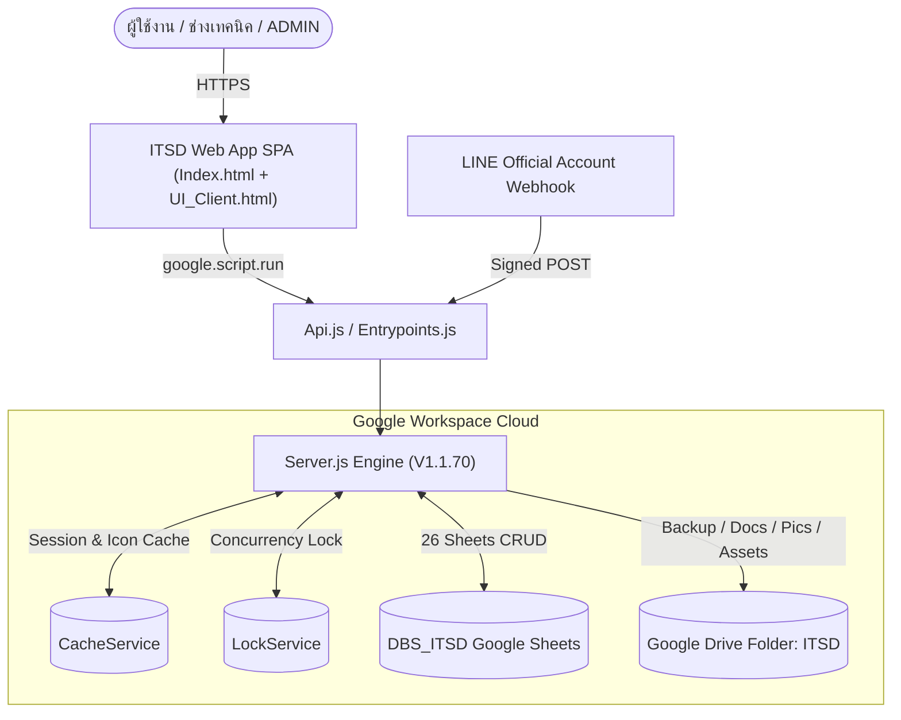
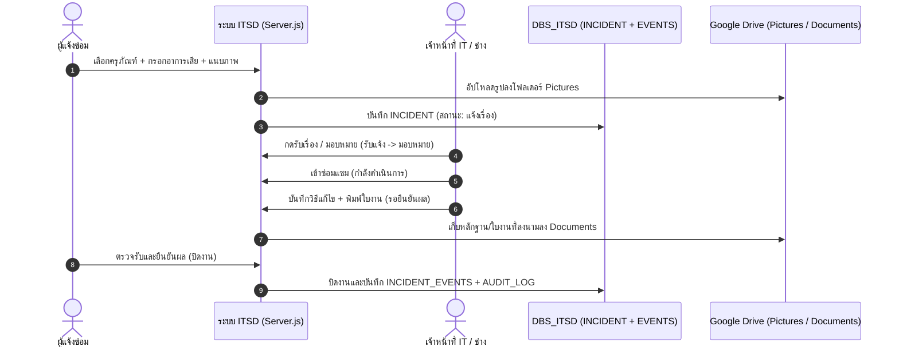

# 🛠️ IT Service Desk : ระบบแจ้งซ่อม บริหารจัดการงานครุภัณฑ์

<div align="center">

### Next-Gen Serverless IT Service Desk, Asset Inventory Management & Automated Workflow Suite

[](https://github.com/thakot-cloud/ITServiceDesk)
[](https://github.com/thakot-cloud/ITServiceDesk)
[](https://github.com/thakot-cloud)
[](https://script.google.com/home/projects/1drKyOpXXRBkf9s9uFXZi6h3PoSy1Ud-SfqMkx8xPyDNNl1XWxcGiVUF7/edit)
[-0F9D58?style=flat-square&logo=googlesheets)](https://docs.google.com/spreadsheets/d/1i-yE0Lg2gILkLENEpk8t1Q9OSVlGpOoximunZwbxF4c/edit)
[](LICENSE)

**🌐 URL ใช้งานระบบจริง (Web App Production URL):**  
[https://script.google.com/macros/s/AKfycbxPnpvvQqmD5FrkHhLIqEdGsX-mCpV5R57G5SrTVPNQ87zxViX_4ObmRvsL0fayTps/exec](https://script.google.com/macros/s/AKfycbxPnpvvQqmD5FrkHhLIqEdGsX-mCpV5R57G5SrTVPNQ87zxViX_4ObmRvsL0fayTps/exec)

</div>

---

## 🔗 ลิงก์ทรัพยากรโครงการทั้งหมด (Project Infrastructure Links)

| องค์ประกอบ | ชื่อ / ID | ลิงก์เข้าถึง |
| :--- | :--- | :--- |
| **GitHub Repository** | `thakot-cloud/ITServiceDesk` | https://github.com/thakot-cloud/ITServiceDesk |
| **Google Drive Root** | `ITSD` (`13LSPwXw4tEkw-F4wGJO9Q2qbn9RZx5Oe`) | https://drive.google.com/drive/folders/13LSPwXw4tEkw-F4wGJO9Q2qbn9RZx5Oe |
| **Google Sheets Database** | `DBS_ITSD` (`1i-yE0Lg2gILkLENEpk8t1Q9OSVlGpOoximunZwbxF4c`) | https://docs.google.com/spreadsheets/d/1i-yE0Lg2gILkLENEpk8t1Q9OSVlGpOoximunZwbxF4c/edit |
| **Apps Script Project (Edit)** | `ITServiceDesk` (`1drKyOpXXRBkf9s9uFXZi6h3PoSy1Ud-SfqMkx8xPyDNNl1XWxcGiVUF7`) | https://script.google.com/home/projects/1drKyOpXXRBkf9s9uFXZi6h3PoSy1Ud-SfqMkx8xPyDNNl1XWxcGiVUF7/edit |
| **Web App Deploy (Exec)** | `AKfycbxPnpvv...` (`ITSD V1.2.08` · Production Deployment) | https://script.google.com/macros/s/AKfycbxPnpvvQqmD5FrkHhLIqEdGsX-mCpV5R57G5SrTVPNQ87zxViX_4ObmRvsL0fayTps/exec |

---

## 📖 สารบัญ
1. [ภาพรวมของระบบ (Overview)](#-ภาพรวมของระบบ-overview)
2. [ผังสถาปัตยกรรมและ Workflow หลัก](#-ผังสถาปัตยกรรมและ-workflow-หลัก)
3. [ความสามารถหลักของระบบ (Key Features)](#-ความสามารถหลักของระบบ-key-features)
4. [โครงสร้างฐานข้อมูล Google Sheets (`DBS_ITSD` — 26 ตาราง)](#-โครงสร้างฐานข้อมูล-google-sheets-dbs_itsd--26-ตาราง)
5. [โครงสร้างไฟล์โค้ดของระบบ (Codebase Architecture)](#-โครงสร้างไฟล์โค้ดของระบบ-codebase-architecture)
6. [บัญชีผู้ใช้เริ่มต้นสำหรับการทดสอบ (Default Accounts)](#-บัญชีผู้ใช้เริ่มต้นสำหรับการทดสอบ-default-accounts)
7. [เอกสารคู่มือฉบับสมบูรณ์ (Full Documentation)](#-เอกสารคู่มือฉบับสมบูรณ์-full-documentation)

---

## 🌟 ภาพรวมของระบบ (Overview)

**ITSD : ITServiceDesk (ระบบแจ้งซ่อมออนไลน์ และการจัดการครุภัณฑ์ไอที)** พัฒนาขึ้นด้วยสถาปัตยกรรม **100% Serverless** บน Google Workspace โดยใช้ **Google Apps Script (V8)** ขับเคลื่อน Single Page Application (SPA) เชื่อมต่อกับ **Google Sheets (`DBS_ITSD`)** เป็นฐานข้อมูลหลัก และจัดเก็บเอกสาร/รูปภาพ/ไฟล์สำรองข้อมูลบน **Google Drive (`ITSD`)**

**จุดเด่นสำคัญใน V1.2.08:**
- **Thai Official Holidays Auto-Import & PM Calendar Integration (V1.2.08)**: ฟังก์ชันดึงวันหยุดราชการไทยอัตโนมัติในเมนูตั้งค่าระบบ > จัดการวันหยุด เลือกล่วงหน้าได้ 3–5 ปี (พ.ศ. 2569–2573) และนำไปไฮไลต์บนปฏิทินแผน PM อัตโนมัติ
- **Sticker Template & Batch A4 Printing (V1.2.07–V1.2.08)**: แท็บแม่แบบสติ๊กเกอร์และการพิมพ์สติ๊กเกอร์เป็นชุด A4 มาตรฐาน (12/15 ดวง) รองรับการเลือกพิมพ์ครุภัณฑ์ทั้งหมดโดยไม่จำกัดจำนวนรายการ พร้อมระบบพรีวิวสด
- **Role Badge Styling for ITSUPPORT (V1.2.08)**: ปรับสีพื้นหลังบทบาท "ฝ่ายสนับสนุน IT" (ITSUPPORT) ให้เป็นแถบสีม่วงเข้าชุดกับ "เจ้าหน้าที่ IT" (TECHNICIAN) ชัดเจนทั้ง Light และ Dark Mode
- **Dark Theme Admin Dashboard (V1.1.69–V1.1.70)**: ยกเครื่องดีไซน์เป็น Obsidian Carbon (`#0a0a0a` / `#0d0d0d` / `#1a1a1a`) พร้อมปุ่มหลักสีส้มเรืองแสง (`#f97316` → `#ea580c`), การ์ด KPI แบบ Glassmorphic แยกโทนสี, ฟอร์ม `asset-compact-form` ไร้กรอบการ์ดซ้อน, และสลับเป็น Light Mode ได้สมบูรณ์ตามมาตรฐาน WCAG 2.2 AA
- **Auto-Increment Inventory Code (V1.1.68)**: สร้างรหัสอุปกรณ์ใหม่เรียงลำดับจากรหัสล่าสุดอัตโนมัติ (เช่น `INV-TOR70-1651` ➔ `INV-TOR70-1652`) พร้อม LockService ป้องกันรหัสซ้ำซ้อน
- **CM Service Report A4 & Modal Refinement (V1.1.64–V1.1.67)**: ปรับระยะขอบพิมพ์ A4 (`1 cm`), แสดง `JOB NO.` และชื่อหน่วยงานครบถ้วน, จัดตำแหน่งช่อง `โทร.` / `ชั้น`, ค้นหาครุภัณฑ์จาก Inventory และจัดปุ่ม `บันทึก`, `พิมพ์ใบงาน (PDF)`
- **Customizable Project Branding**: ชื่อโครงการ ชื่อย่อ คำอธิบาย และไอคอนระบบ **สามารถแก้ไขได้เองผ่านเมนูตั้งค่าระบบโดย `ADMIN`** (จัดเก็บใน `APP_SETTINGS` และอัปเดตทันทีโดยไม่ต้องแก้โค้ด)
- **Modular 4-Tab Equipment Editing**: จัดเรียงแท็บทะเบียนครุภัณฑ์ (`ข้อมูลทั่วไป` ➔ `คุณลักษณะ` ➔ `การสำรวจ` ➔ `ประวัติแจ้งซ่อม`) พร้อม Modal แก้ไขและบันทึกแยกส่วนอิสระ
- **Unified Google Drive Integration**: เชื่อมโยงโครงสร้างโฟลเดอร์ (`Backup Files`, `Documents`, `Pictures`, `System Assets`) ภายใต้ `13LSPwXw4tEkw-F4wGJO9Q2qbn9RZx5Oe` ครบถ้วน

---

## 🔄 ผังสถาปัตยกรรมและ Workflow หลัก

### 1. สถาปัตยกรรมระบบ (System Architecture)



### 2. วงจรชีวิตใบงานแจ้งซ่อม 6 ขั้นตอน (6-Stage Incident Lifecycle)



*(ดู Data Diagram แบบละเอียดครบทุก 26 ตาราง และ Workflow ทั้งหมดได้ที่ [`DATA_DIAGRAM_AND_WORKFLOW.md`](./DATA_DIAGRAM_AND_WORKFLOW.md))*

---

## 🚀 ความสามารถหลักของระบบ (Key Features)

1. **แดชบอร์ดสถิติและติดตามงาน (KPI Dashboard & Tracking)**: กราฟสรุปสถานะใบงาน, รายการเกินกำหนด, ตัวกรองค้นหาแบบ Real-time และการแจ้งเตือนงาน
2. **ระบบแจ้งซ่อมและใบงานบริการ (Tickets & Work Order PDF)**: รองรับ 6 สถานะมาตรฐาน, ค้นหาจากเลขครุภัณฑ์/ซีเรียลอัตโนมัติ และพิมพ์ใบงาน Service Report (PDF)
3. **ทะเบียนครุภัณฑ์ 4 แท็บแยกส่วนอิสระ (Modular Equipment Registry)**:
   - `ข้อมูลทั่วไป` (`details_only`)
   - `คุณลักษณะ` (`specs_only` — OS, CPU, Speed, RAM, Harddisk, IP)
   - `การสำรวจ` (`survey_only` — วันที่สำรวจ, ผู้ตรวจสอบ, สถานะ)
   - `ประวัติแจ้งซ่อม` (Ticket Timeline)
4. **แผนบำรุงรักษาเชิงป้องกัน (PM Planning)**: บริหารรอบตรวจตามปีงบประมาณไทย ปฏิทิน PM และการบันทึกประวัติตรวจเช็ก
5. **เชื่อมต่อ LINE OA (LINE Inbox Review)**: รับข้อความแจ้งซ่อมผ่าน Webhook พร้อมตรวจรับ/แปลงเป็นใบงานได้ทันที
6. **ตั้งค่าระบบและปรับแต่งแบรนด์โดย ADMIN (Admin Settings & RBAC)**: แก้ไขชื่อโครงการ (`project_name`), ชื่อย่อ (`system_short_name`), คำอธิบาย, ไอคอน 1:1, โฟลเดอร์ Google Drive, Permission Matrix และสำรองฐานข้อมูล (Database Backup)

---

## 🗄️ โครงสร้างฐานข้อมูล Google Sheets (`DBS_ITSD` — 26 ตาราง)

Database ID: **`1i-yE0Lg2gILkLENEpk8t1Q9OSVlGpOoximunZwbxF4c`**

| หมวดหมู่ | รายชื่อชีต (Sheet Names) |
| :--- | :--- |
| **ความปลอดภัยและสิทธิ์ (7 ชีต)** | `APP_USERS`, `APP_USER_PROFILE`, `APP_ROLES`, `APP_ROLE_PERMISSIONS`, `APP_ROLE_ACTION_PERMISSIONS`, `APP_SESSIONS`, `APP_AUDIT_LOG` |
| **ตั้งค่าและข้อมูลหลัก (8 ชีต)** | `APP_SETTINGS`, `APP_LOOKUPS`, `Branding`, `MST_ORG_UNITS`, `MST_DEVICE_MODELS`, `SOFTWARE_LICENSES`, `INVENTORY`, `INVENTORY_SORTED` |
| **ใบงานแจ้งซ่อม (5 ชีต)** | `INCIDENT`, `INCIDENT_META`, `INCIDENT_EVENTS`, `INCIDENT_FILES`, `TICKET_SERVICE_REPORT` |
| **บำรุงรักษาเชิงป้องกัน PM (4 ชีต)** | `PM_PLANNINGS`, `PM_PLANNING_ITEMS`, `PM_PLANS`, `PM_PLAN_HISTORY` |
| **LINE Messaging Integration (2 ชีต)** | `LINE_INBOX`, `LINE_INBOX_REVIEWS` |

---

## 📂 โครงสร้างไฟล์โค้ดของระบบ (Codebase Architecture)

```
ITSD/
├── .clasp.json                      # เชื่อม Apps Script Project 1G24xk... (rootDir: src)
├── README.md                        # ภาพรวมโครงการและลิงก์อ้างอิงทั้งหมด
├── DATA_DIAGRAM_AND_WORKFLOW.md     # ER Diagram 26 ตาราง + ผัง Workflow ทั้งระบบ
├── MANUAL_USER.md                   # คู่มือการใช้งานระบบฉบับสมบูรณ์
├── INSTALL_GUIDE.md                 # คู่มือการติดตั้งและตั้งค่าฉบับสมบูรณ์
├── PATCH_NOTES.md                   # ประวัติการพัฒนาและ Release Notes
├── COLOR_TEMPLATE.md                # สเปกชุดสีมาตรฐาน UI
└── src/                             # Source Code หลักสำหรับ Deploy ขึ้น Google Apps Script
    ├── appsscript.json              # Manifest (Asia/Bangkok, V8, OAuth Scopes)
    ├── Entrypoints.js               # doGet() และ doPost()
    ├── Api.js                       # Public API Facade (google.script.run)
    ├── Server.js                    # Core Enterprise Engine (V1.1.70)
    ├── Index.html                   # Web App Shell & Login Layout
    ├── UI_Client.html               # Client Controllers & SPA Views
    ├── UI_Styles.html               # Theme Tokens (Dark Theme Admin Dashboard / Dark & Light)
    └── UI_Templates.html            # HTML Templates
```

---

## 👥 บัญชีผู้ใช้ในระบบจริง (System Accounts)

| ลำดับ | Username | ชื่อ-นามสกุล | บทบาท (Role) | อีเมลที่ผูกกับบัญชี | ขอบเขตสิทธิ์การใช้งาน | สถานะ |
| :---: | :---: | :--- | :---: | :--- | :--- | :---: |
| 1 | **`ADMIN`** | ผู้ดูแลระบบ | **ADMIN** | `c.thakot@gmail.com` | สิทธิ์สูงสุด ควบคุมทุกโมดูล จัดการผู้ใช้ และการตั้งค่าระบบ | ใช้งานอยู่ |
| 2 | **`MANAGER`** | ผู้จัดการ | **MANAGER** | `c.thakot@gmail.com` | บริหารจัดการ ดูแลภาพรวม มอบหมายงาน ตรวจสอบรายงาน | ใช้งานอยู่ |
| 3 | **`TECHNICIAN`** | เจ้าหน้าที่ IT | **TECHNICIAN** | `c.thakot@gmail.com` | ดำเนินการงานซ่อมบำรุง CM/PM บันทึกผล และพิมพ์รายงาน | ใช้งานอยู่ |
| 4 | **`ITSUPPORT`** | ทศพล กาญจนพันธ์ | **ITSUPPORT** | `thodsaphon@opentechnology.co.th` | ฝ่ายสนับสนุน IT บันทึกข้อมูลครุภัณฑ์ สำรวจอุปกรณ์ ตรวจเช็ค | ใช้งานอยู่ |
| 5 | **`USER001`** | ชัยวุฒิ ศรีแก้ว | **USER** | `chaiwut@opentechnology.co.th` | ผู้ใช้งานทั่วไป เปิดแจ้งซ่อม ติดตามสถานะงาน | ใช้งานอยู่ |
| 6 | **`USER002`** | วินยาดา บึงกระเสริม | **USER** | `winyada.b@opentechnology.co.th` | ผู้ใช้งานทั่วไป เปิดแจ้งซ่อม ติดตามสถานะงาน | ใช้งานอยู่ |
| 7 | **`USER003`** | วีรภัทร ธนันกา | **USER** | `weerapat@opentechnology.co.th` | ผู้ใช้งานทั่วไป เปิดแจ้งซ่อม ติดตามสถานะงาน | ใช้งานอยู่ |

> [!NOTE]
> **นโยบายความปลอดภัยและรหัสผ่าน (Security & Password Policy)**:
> - รหัสผ่านในระบบจริงจัดเก็บด้วยการเข้ารหัสแบบทางเดียว (One-Way Hashing: SHA-256 พร้อม Salt เฉพาะผู้ใช้) ตามมาตรฐานความปลอดภัย เพื่อป้องกันการรั่วไหล ไม่มีการเปิดเผยรหัสผ่านจริงบนเอกสารสาธารณะ
> - **การรีเซ็ตรหัสผ่าน**: ผู้ดูแลระบบ (`ADMIN`) สามารถรีเซ็ตรหัสผ่านให้แก่ผู้ใช้ได้ผ่านเมนู **ตั้งค่าระบบ → จัดการผู้ใช้** (กดปุ่มรูปกุญแจ 🔑) หรือผู้ใช้สามารถกดลิงก์ **"ลืมรหัสผ่าน"** ที่หน้า Login เพื่อขอรับรหัส OTP ยืนยันตัวตนผ่านอีเมลที่ลงทะเบียนไว้
> - **มาตรฐานรหัสผ่าน**: เป็นไปตามเกณฑ์ NIST SP 800-63B (ความยาวขั้นต่ำ 12–15 ตัวอักษร) และระบบจะทำการล็อกบัญชีชั่วคราวอัตโนมัติหากกรอกรหัสผ่านผิดติดต่อกันเกิน 5 ครั้ง

---

## 📚 เอกสารคู่มือฉบับสมบูรณ์ (Full Documentation)

- **คู่มือการใช้งานระบบฉบับสมบูรณ์**: [`MANUAL_USER.md`](./MANUAL_USER.md)
- **คู่มือการติดตั้งและตั้งค่าระบบฉบับสมบูรณ์**: [`INSTALL_GUIDE.md`](./INSTALL_GUIDE.md)
- **Data Diagram (ER 26 ตาราง) & System Workflows**: [`DATA_DIAGRAM_AND_WORKFLOW.md`](./DATA_DIAGRAM_AND_WORKFLOW.md)
- **บันทึกการเปลี่ยนแปลง (Patch Notes)**: [`PATCH_NOTES.md`](./PATCH_NOTES.md)

---

<div align="center">
  <sub>พัฒนาและดูแลโดย LongZe Design © 2026 ITSD : ITServiceDesk (ระบบแจ้งซ่อมออนไลน์ และการจัดการครุภัณฑ์ไอที)</sub>
</div>
