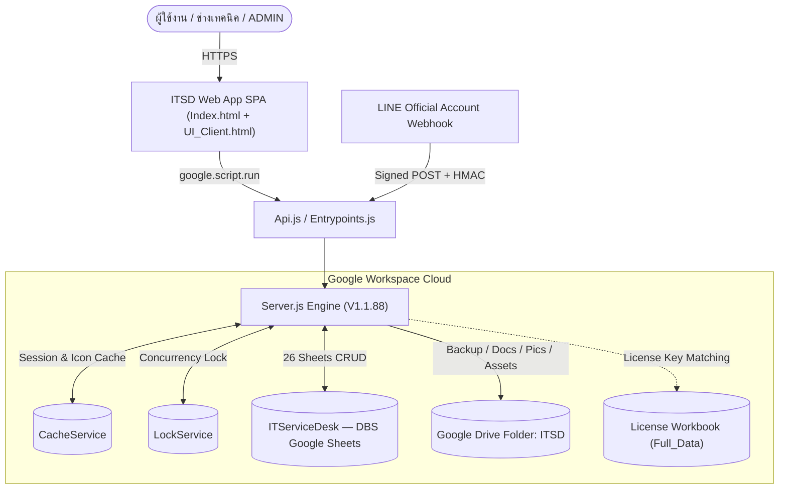
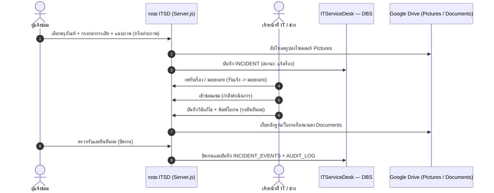

# 🛠️ ITSD : ITServiceDesk (ระบบแจ้งซ่อมออนไลน์ และการจัดการครุภัณฑ์ไอที)

<div align="center">

### Next-Gen Serverless IT Service Desk, Asset Inventory Management & Automated Workflow Suite

[](https://github.com/thakot-cloud/ITServiceDesk)
[](https://github.com/thakot-cloud/ITServiceDesk)
[](https://github.com/longzedesign-dotcom)
[](https://script.google.com/home/projects/1drKyOpXXRBkf9s9uFXZi6h3PoSy1Ud-SfqMkx8xPyDNNl1XWxcGiVUF7/edit)
[-0F9D58?style=flat-square&logo=googlesheets)](https://docs.google.com/spreadsheets/d/1i-yE0Lg2gILkLENEpk8t1Q9OSVlGpOoximunZwbxF4c/edit)
[](LICENSE)

**🌐 URL ใช้งานระบบจริง (Web App Production URL):**<br>
[https://script.google.com/macros/s/AKfycbxPnpvvQqmD5FrkHhLIqEdGsX-mCpV5R57G5SrTVPNQ87zxViX_4ObmRvsL0fayTps/exec](https://script.google.com/macros/s/AKfycbxPnpvvQqmD5FrkHhLIqEdGsX-mCpV5R57G5SrTVPNQ87zxViX_4ObmRvsL0fayTps/exec)

</div>

---

## 🔗 ลิงก์ทรัพยากรโครงการทั้งหมด (Project Infrastructure Links)

| องค์ประกอบ | ชื่อ / ID | ลิงก์เข้าถึง |
| :--- | :--- | :--- |
| **GitHub Repository** | `thakot-cloud/ITServiceDesk` | https://github.com/thakot-cloud/ITServiceDesk |
| **Upstream Repository** | `longzedesign-dotcom/ITServiceDesk` | https://github.com/longzedesign-dotcom/ITServiceDesk |
| **Google Drive Root** | `ITSD` (`13LSPwXw4tEkw-F4wGJO9Q2qbn9RZx5Oe`) | https://drive.google.com/drive/folders/13LSPwXw4tEkw-F4wGJO9Q2qbn9RZx5Oe |
| **Google Sheets Database** | `ITServiceDesk — DBS` (`1i-yE0Lg2gILkLENEpk8t1Q9OSVlGpOoximunZwbxF4c`) | https://docs.google.com/spreadsheets/d/1i-yE0Lg2gILkLENEpk8t1Q9OSVlGpOoximunZwbxF4c/edit |
| **License ต้นฉบับ** | `License` / `Full_Data` (`1ZiBugthGA-lD8KTAqntK6ckboTLlqoU61X-FpBdEIL4`) | https://docs.google.com/spreadsheets/d/1ZiBugthGA-lD8KTAqntK6ckboTLlqoU61X-FpBdEIL4/edit |
| **Apps Script Project (Edit)** | `ITSD_CLASP_STAGING` (`1drKyOpXXRBkf9s9uFXZi6h3PoSy1Ud-SfqMkx8xPyDNNl1XWxcGiVUF7`) | https://script.google.com/home/projects/1drKyOpXXRBkf9s9uFXZi6h3PoSy1Ud-SfqMkx8xPyDNNl1XWxcGiVUF7/edit |
| **Web App Deploy (Exec)** | `AKfycbxPnpvvQqmD5FrkHhLIqEdGsX-mCpV5R57G5SrTVPNQ87zxViX_4ObmRvsL0fayTps` (`ITSD V1.1.88` · Deployment `@144`) | https://script.google.com/macros/s/AKfycbxPnpvvQqmD5FrkHhLIqEdGsX-mCpV5R57G5SrTVPNQ87zxViX_4ObmRvsL0fayTps/exec |

---

## 📖 สารบัญ
1. [ภาพรวมของระบบ (Overview)](#-ภาพรวมของระบบ-overview)
2. [ผังสถาปัตยกรรมและ Workflow หลัก](#-ผังสถาปัตยกรรมและ-workflow-หลัก)
3. [ความสามารถหลักของระบบ (Key Features)](#-ความสามารถหลักของระบบ-key-features)
4. [โครงสร้างฐานข้อมูล Google Sheets (`DBS` — 26 ตาราง)](#-โครงสร้างฐานข้อมูล-google-sheets-dbs--26-ตาราง)
5. [โครงสร้างไฟล์โค้ดของระบบ (Codebase Architecture)](#-โครงสร้างไฟล์โค้ดของระบบ-codebase-architecture)
6. [บัญชีผู้ใช้เริ่มต้นสำหรับการทดสอบ (Default Accounts)](#-บัญชีผู้ใช้เริ่มต้นสำหรับการทดสอบ-default-accounts)
7. [การตรวจสอบและทดสอบระบบ (Verification & Testing)](#-การตรวจสอบและทดสอบระบบ-verification--testing)
8. [หลักความปลอดภัยและข้อกำหนดสำคัญ (Security & Governance)](#-หลักความปลอดภัยและข้อกำหนดสำคัญ-security--governance)
9. [เอกสารคู่มือฉบับสมบูรณ์ (Full Documentation)](#-เอกสารคู่มือฉบับสมบูรณ์-full-documentation)

---

## 🌟 ภาพรวมของระบบ (Overview)

**ITSD : ITServiceDesk (ระบบแจ้งซ่อมออนไลน์ และการจัดการครุภัณฑ์ไอที)** พัฒนาขึ้นด้วยสถาปัตยกรรม **100% Serverless** บน Google Workspace โดยใช้ **Google Apps Script (V8)** ขับเคลื่อน Single Page Application (SPA) เชื่อมต่อกับ **Google Sheets (`ITServiceDesk — DBS`)** เป็นฐานข้อมูลหลัก และจัดเก็บเอกสาร/รูปภาพ/ไฟล์สำรองข้อมูลบน **Google Drive (`ITSD`)**

**จุดเด่นและฟีเจอร์สำคัญใน V1.1.80 – V1.1.88:**
- **User Profile Photo & Camera Capture (V1.1.88)**: หน้าต่างข้อมูลบัญชีผู้ใช้รองรับการอัปโหลดรูปภาพโปรไฟล์จากเครื่องคอมพิวเตอร์/มือถือ และสามารถเปิดกล้องเพื่อถ่ายรูปโปรไฟล์ได้ทันที พร้อมระบบบีบอัดและแสดงผลทันที
- **Sidebar Capsule Admin Profile Button (V1.1.87)**: ปรับแต่งปุ่มโปรไฟล์ผู้ดูแลระบบด้านล่างของ Sidebar ให้มีขอบมนโค้งมน (Capsule Rounded Corner `border-radius: 9999px`) สอดคล้องกับปุ่มตั้งค่าระบบอย่างกลมกลืน
- **Monthly CM Service Report 16 Columns (V1.1.86)**: รายงานแจ้งซ่อมประจำเดือน (CM) จัดเรียง 16 คอลัมน์มาตรฐาน พร้อมแถบหัวตารางสีฟ้าอ่อน (`#EBF5FB`) รองรับการส่งออกเป็น Excel (.xlsx), CSV และ PDF
- **Ticket Modal Action Bar & Compact Attachments (V1.1.85)**: ปรับตำแหน่งปุ่ม `อัปเดตสถานะ`, `ข้อมูลใบงาน`, `พิมพ์ใบงาน (PDF)` ให้อยู่ในแนวระนาบเดียวกัน พร้อมจัดแถบแนบเอกสารแสดงผลเป็น 1 บรรทัดกระชับสายตา
- **Dark Theme Admin Dashboard & Style 5 Orange Energy**: อินเทอร์เฟซ Obsidian Carbon ทันสมัย รองรับทั้ง Dark Theme และ Light Theme พร้อมคู่สีส้มเรืองแสง (`#FA7737` / `#F97316`) ตามมาตรฐาน WCAG 2.2 AA
- **Auto-Increment Inventory Code**: สร้างรหัสอุปกรณ์ใหม่เรียงลำดับต่อเนื่องอัตโนมัติ (เช่น `INV-TOR70-1651` ➔ `INV-TOR70-1652`) ป้องกันการซ้ำซ้อนด้วย LockService
- **Modular 4-Tab Equipment Editing**: แท็บทะเบียนครุภัณฑ์แยกส่วน (`ข้อมูลทั่วไป` ➔ `คุณลักษณะ` ➔ `การสำรวจ` ➔ `ประวัติแจ้งซ่อม`) พร้อม Modal บันทึกแยกอิสระ
- **Software License Integration & Masked Mode**: จัดการคีย์ลิขสิทธิ์ซอฟต์แวร์แบบ Masked / Reveal ด้วยรหัสผ่านยืนยัน 60 วินาที พร้อม Audit Log บันทึกทุกความเคลื่อนไหว

---

## 🔄 ผังสถาปัตยกรรมและ Workflow หลัก

### 1. สถาปัตยกรรมระบบ (System Architecture)



### 2. วงจรชีวิตใบงานแจ้งซ่อม 6 ขั้นตอน (6-Stage Incident Lifecycle)



*(ดู Data Diagram แบบละเอียดครบทุก 26 ตาราง และ Workflow ทั้งหมดได้ที่ [`DATA_DIAGRAM_AND_WORKFLOW.md`](./DATA_DIAGRAM_AND_WORKFLOW.md))*

---

## 🚀 ความสามารถหลักของระบบ (Key Features)

1. **แดชบอร์ดสถิติและติดตามงาน (KPI Dashboard & Tracking)**: กราฟสรุปสถานะใบงาน, รายการเกินกำหนด, ตัวกรองค้นหาแบบ Real-time และการแจ้งเตือนงาน
2. **ระบบแจ้งซ่อมและใบงานบริการ (Tickets & Work Order PDF)**: รองรับ 6 สถานะมาตรฐาน, ค้นหาจากเลขครุภัณฑ์/ซีเรียลอัตโนมัติ และพิมพ์ใบงาน Service Report (PDF)
3. **ทะเบียนครุภัณฑ์ 4 แท็บแยกส่วนอิสระ (Modular Equipment Registry)**:
   - `ข้อมูลทั่วไป` (`details_only`)
   - `คุณลักษณะ` (`specs_only` — OS, CPU, Speed, RAM, Harddisk, IP)
   - `การสำรวจ` (`survey_only` — วันที่สำรวจ, ผู้ตรวจสอบ, สถานะ)
   - `ประวัติแจ้งซ่อม` (Ticket Timeline)
4. **แผนบำรุงรักษาเชิงป้องกัน (PM Planning)**: บริหารรอบตรวจตามปีงบประมาณไทย ปฏิทิน PM และการบันทึกประวัติตรวจเช็ก
5. **เชื่อมต่อ LINE OA (LINE Inbox Review)**: รับข้อความแจ้งซ่อมผ่าน Webhook พร้อมตรวจรับ/แปลงเป็นใบงานได้ทันที
6. **จัดการสิทธิ์และผู้ใช้ (RBAC & Governance)**: สิทธิ์ 5 ระดับ (`ADMIN`, `MANAGER`, `TECHNICIAN`, `ITSUPPORT`, `USER`), ปรับ Permission Matrix, อัปโหลดภาพโปรไฟล์/ถ่ายภาพผ่านกล้อง
7. **ตั้งค่าระบบและปรับแต่งแบรนด์โดย ADMIN (Admin Settings & RBAC)**: แก้ไขชื่อโครงการ (`project_name`), ชื่อย่อ (`system_short_name`), คำอธิบาย, ไอคอน 1:1, โฟลเดอร์ Google Drive, และสำรองฐานข้อมูล (Database Backup)

---

## 🗄️ โครงสร้างฐานข้อมูล Google Sheets (`DBS` — 26 ตาราง)

Database ID: **`1i-yE0Lg2gILkLENEpk8t1Q9OSVlGpOoximunZwbxF4c`**

| หมวดหมู่ | รายชื่อชีต (Sheet Names) |
| :--- | :--- |
| **ความปลอดภัยและสิทธิ์ (7 ชีต)** | `APP_USERS`, `APP_USER_PROFILE`, `APP_ROLES`, `APP_ROLE_PERMISSIONS`, `APP_ROLE_ACTION_PERMISSIONS`, `APP_SESSIONS`, `APP_AUDIT_LOG` |
| **ตั้งค่าและข้อมูลหลัก (8 ชีต)** | `APP_SETTINGS`, `APP_LOOKUPS`, `Branding`, `MST_ORG_UNITS`, `MST_DEVICE_MODELS`, `SOFTWARE_LICENSES`, `INVENTORY`, `INVENTORY_SORTED` |
| **ใบงานแจ้งซ่อม (5 ชีต)** | `INCIDENT`, `INCIDENT_META`, `INCIDENT_EVENTS`, `INCIDENT_FILES`, `TICKET_SERVICE_REPORT` |
| **บำรุงรักษาเชิงป้องกัน PM (4 ชีต)** | `PM_PLANNINGS`, `PM_PLANNING_ITEMS`, `PM_PLANS`, `PM_PLAN_HISTORY` |
| **LINE Messaging Integration (2 ชีต)** | `LINE_INBOX`, `LINE_INBOX_REVIEWS` |

---

## 📂 โครงสร้างไฟล์โค้ดของระบบ (Codebase Architecture)

```
ITSD_CLASP_STAGING/SERVER_2026/
├── .clasp.json                      # เชื่อม Apps Script Project 1drKyOp...
├── README.md                        # ภาพรวมโครงการ ลิงก์อ้างอิง และคู่มือสรุป
├── DATA_DIAGRAM_AND_WORKFLOW.md     # ER Diagram 26 ตาราง + ผัง Workflow ทั้งระบบ
├── MANUAL_USER.md                   # คู่มือการใช้งานระบบฉบับสมบูรณ์
├── INSTALL_GUIDE.md                 # คู่มือการติดตั้งและตั้งค่าฉบับสมบูรณ์
├── PATCH_NOTES.md                   # ประวัติการพัฒนาและ Release Notes ถึง V1.1.88
├── COLOR_TEMPLATE.md                # สเปกชุดสีมาตรฐาน UI (Style 5 Orange Energy)
├── Entrypoints.js                   # doGet() และ doPost()
├── Api.js                           # Public API Facade (google.script.run)
├── Server.js                        # Core Enterprise Engine (V1.1.88)
├── Index.html                       # Web App Shell & Login Layout
├── UI_Client.html                   # Client Controllers & SPA Views
├── UI_Styles.html                   # Theme Tokens (Dark Theme Admin Dashboard / Dark & Light)
├── UI_Templates.html                # HTML Templates
├── appsscript.json                  # Manifest (Asia/Bangkok, V8, OAuth Scopes)
└── tests/                           # Automated Verification Tests
    ├── next-inventory-id.test.js
    └── license-matching.test.js
```

---

## 👥 บัญชีผู้ใช้งานจริงในระบบ (System Users)

| รหัสผู้ใช้ (User ID) | Username | ชื่อแสดง (Display Name) | สิทธิ์ (Role) | ตำแหน่ง (Position) | อีเมล / เบอร์โทรศัพท์ | สถานะ |
| :---: | :---: | :--- | :---: | :--- | :--- | :---: |
| **USR-ADMIN** | `ADMIN` | ผู้ดูแลระบบ | **ADMIN** | Administrators | `c.thakot@gmail.com`<br>`064-224-9454` | พร้อมใช้งาน |
| **USR-MANAGER** | `MANAGER` | ผู้จัดการ | **MANAGER** | Manager | `c.thakot@gmail.com`<br>`064-224-9454` | พร้อมใช้งาน |
| **USR-TECHNICIAN** | `TECHNICIAN` | เจ้าหน้าที่ IT | **TECHNICIAN** | Technician | `c.thakot@gmail.com`<br>`064-224-9454` | พร้อมใช้งาน |
| **USR-ITSUPPORT** | `ITSUPPORT` | ทศพล กาญจนพันธ์ | **ITSUPPORT** | IT Support | `thodsaphon@opentechnology.co.th`<br>`099-329-0899` | พร้อมใช้งาน |
| **USR-USER01** | `USER001` | ชัยวุฒิ ศรีแก้ว | **ITSUPPORT** | IT Support | `chaiwut@opentechnology.co.th`<br>`097-130-3369` | พร้อมใช้งาน |
| **USR-USER02** | `USER002` | วินยาดา บึงกระเสริม | **USER** | IT Support | `winyada.b@opentechnology.co.th`<br>`082-296-9649` | พร้อมใช้งาน |
| **USR-USER03** | `USER003` | วีรภัทร  ธนันทา | **USER** | IT Support | `weerapat@opentechnology.co.th`<br>`061-293-3939` | พร้อมใช้งาน |

---

## 🧪 การตรวจสอบและทดสอบระบบ (Verification & Testing)

คำสั่งตรวจสอบโค้ดและความถูกต้องก่อนส่งมอบงาน:

```bash
cd /Users/chaloem/Apps_Script/ITSD_CLASP_STAGING/SERVER_2026

# ตรวจสอบสถานะ git
git status --short --branch
git diff --check

# ตรวจสอบ syntax โค้ด JavaScript
node --check Server.js
node --check Api.js
node --check Entrypoints.js

# รัน Automated Unit Tests
node --test tests/next-inventory-id.test.js tests/license-matching.test.js

# ตรวจสอบ Clasp Deployments
clasp list-deployments
```

---

## 🔒 หลักความปลอดภัยและข้อกำหนดสำคัญ (Security & Governance)

- **ห้ามเก็บ Secret ในโค้ดหรือ Git**: ห้าม commit password, session token, HMAC key, LINE secret, หรือ credentials
- **คง Deployment ID เดิมเสมอ**: เมื่อ deploy ต้องระบุ `--deploymentId AKfycbxPnpvvQqmD5FrkHhLIqEdGsX-mCpV5R57G5SrTVPNQ87zxViX_4ObmRvsL0fayTps` เพื่อไม่ให้ URL `/exec` เปลี่ยน
- **สำรองข้อมูลก่อนปรับแก้ใหญ่**: สร้าง backup ผ่าน Admin Settings และ pull สำรอง source ก่อนแก้ไขทุกครั้ง
- **ไม่แก้ประวัติใน Google Sheets โดยพลการ**: ห้ามเปลี่ยน/ลบเลข Ticket หรือ `รหัสอุปกรณ์` ที่มีประวัติอ้างอิงโดยไม่มี mapping report และการอนุมัติ

---

## 📚 เอกสารคู่มือฉบับสมบูรณ์ (Full Documentation)

- **คู่มือการใช้งานระบบฉบับสมบูรณ์**: [`MANUAL_USER.md`](./MANUAL_USER.md)
- **คู่มือการติดตั้งและตั้งค่าระบบฉบับสมบูรณ์**: [`INSTALL_GUIDE.md`](./INSTALL_GUIDE.md)
- **Data Diagram (ER 26 ตาราง) & System Workflows**: [`DATA_DIAGRAM_AND_WORKFLOW.md`](./DATA_DIAGRAM_AND_WORKFLOW.md)
- **บันทึกการเปลี่ยนแปลง (Patch Notes)**: [`PATCH_NOTES.md`](./PATCH_NOTES.md)
- **สเปกแม่แบบชุดสี (Color Template)**: [`COLOR_TEMPLATE.md`](./COLOR_TEMPLATE.md)

---

<div align="center">
  <sub>พัฒนาและดูแลโดย LongZe Design © 2026 ITSD : ITServiceDesk (ระบบแจ้งซ่อมออนไลน์ และการจัดการครุภัณฑ์ไอที)</sub>
</div>
