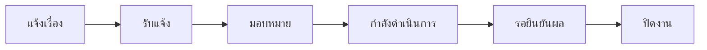
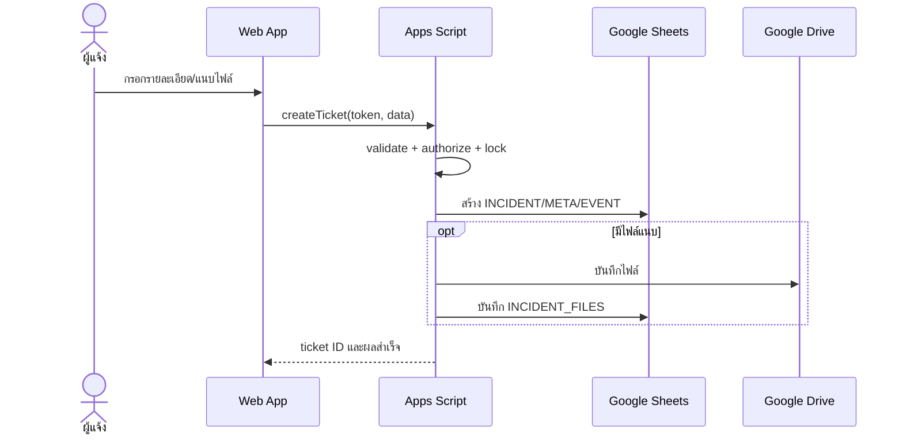
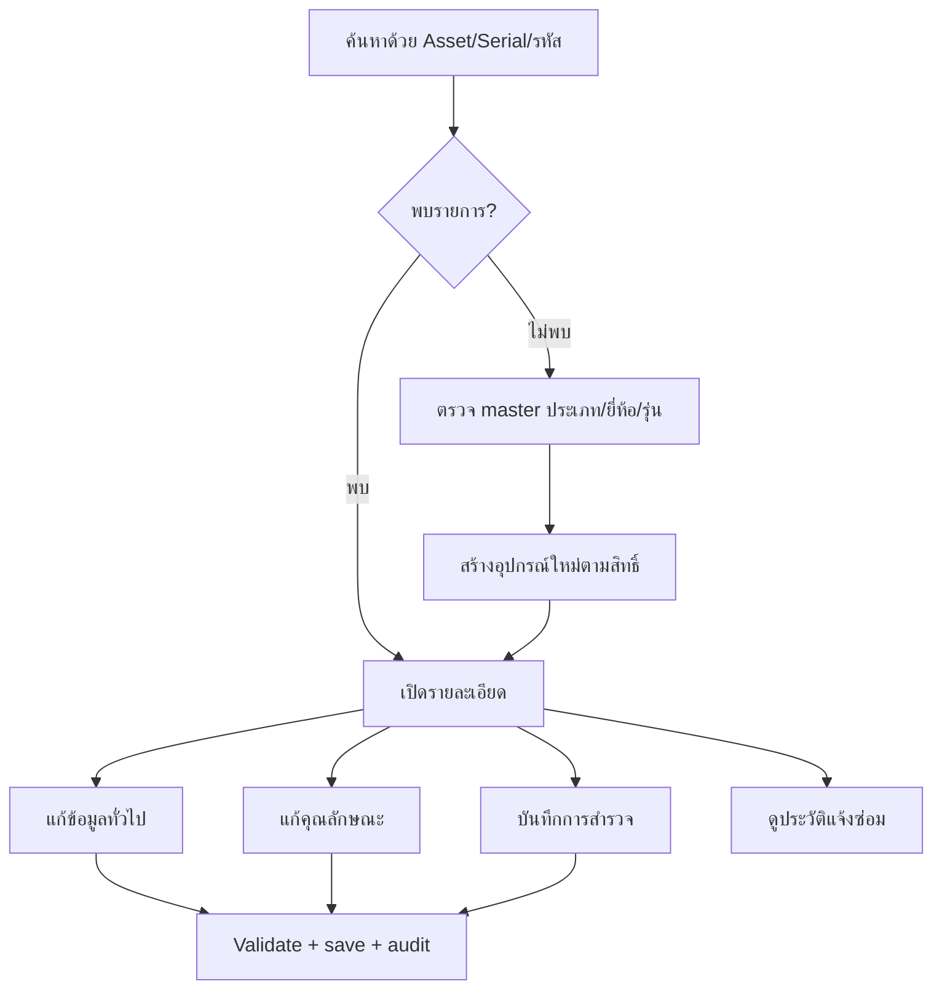
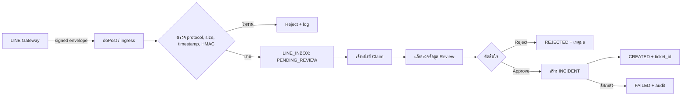
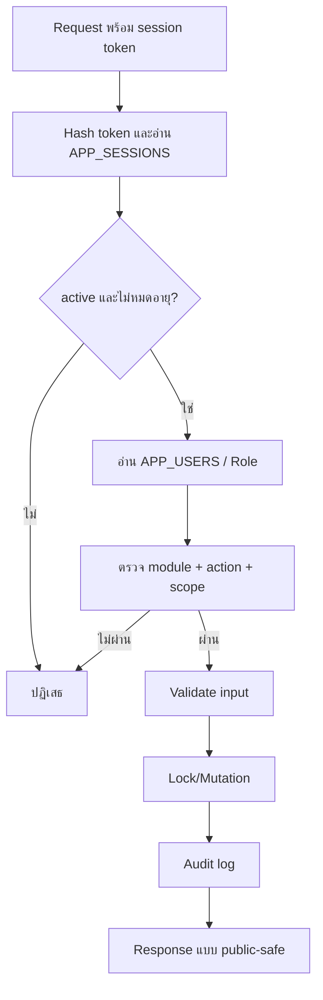

# Workflow ของ IT Service Desk

## 1. Ticket lifecycle

ทุก transition ตรวจ session, permission และสถานะปัจจุบันฝั่ง server แล้วบันทึก `INCIDENT`, `INCIDENT_META` และ `INCIDENT_EVENTS` ตามหน้าที่ ก่อนรอยืนยันผล/ปิดงานต้องมีรายละเอียดการแก้ไข

## 2. ครุภัณฑ์และการสำรวจ

ข้อมูลทั่วไป คุณลักษณะ การสำรวจ และประวัติแจ้งซ่อมแยกแท็บ/ขอบเขตการบันทึก เพื่อลดการเขียนทับข้อมูลที่ไม่ได้แก้

## 3. LINE Inbox

## 4. Permission flow

UI ใช้ permission เพื่อซ่อน/แสดง controls แต่ server permission เป็นแหล่งตัดสินสิทธิ์จริง

## 5. Development และ Release

```mermaid
flowchart LR
  A[ยืนยัน Local/Git/Script/DB/Deployment] --> B[สำรอง source]
  B --> C[clasp pull]
  C --> D[Commit checkpoint]
  D --> E[แก้ source + patch version]
  E --> F[Syntax/security/secret checks]
  F --> G[Commit แบบ atomic]
  G --> H[Fetch และ push GitHub main]
  H --> I{ได้รับอนุมัติ deploy?}
  I -- ยัง --> J[หยุดที่ source พร้อมรายงาน]
  I -- ได้รับ --> K[clasp push]
  K --> L[สร้าง Apps Script version]
  L --> M[อัปเดต deployment ID เดิม]
  M --> N[HTTP + functional + log verification]
  N --> O[บันทึก release/rollback point]
```

กฎสำคัญ:

- `clasp pull` สำรอง source ก่อนเสมอ
- GitHub และ Apps Script เป็นคนละขั้นตอน; push GitHub ไม่ได้เปลี่ยน Production Web App
- ห้ามสร้าง deployment ใหม่เมื่อเป้าหมายคือรักษา `/exec` URL เดิม
- หาก validation ไม่ผ่าน ห้าม push/deploy
- Rollback source ด้วย commit ใหม่ และ rollback runtime ด้วย version ที่ deployment ID เดิม
