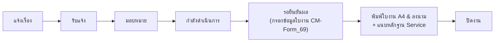
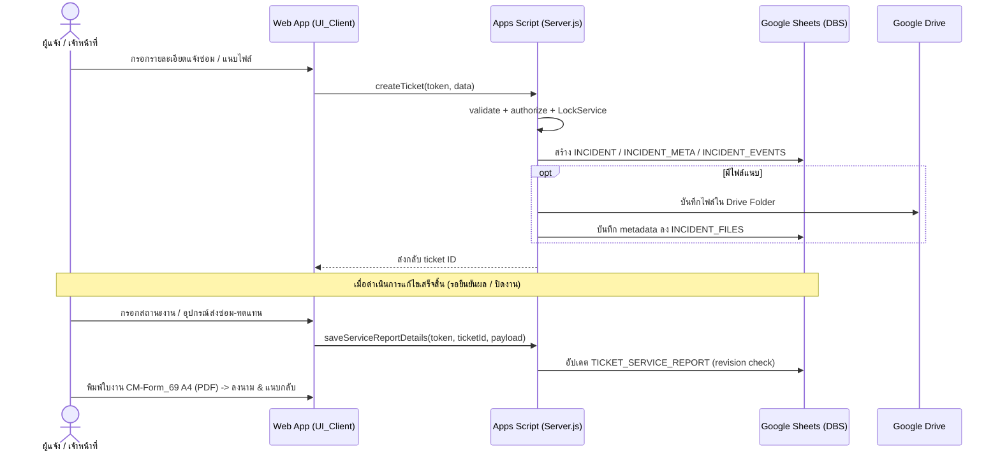
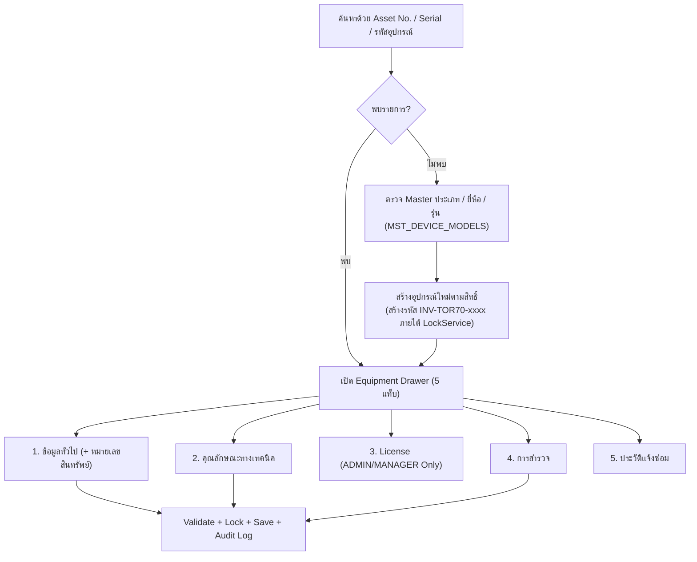
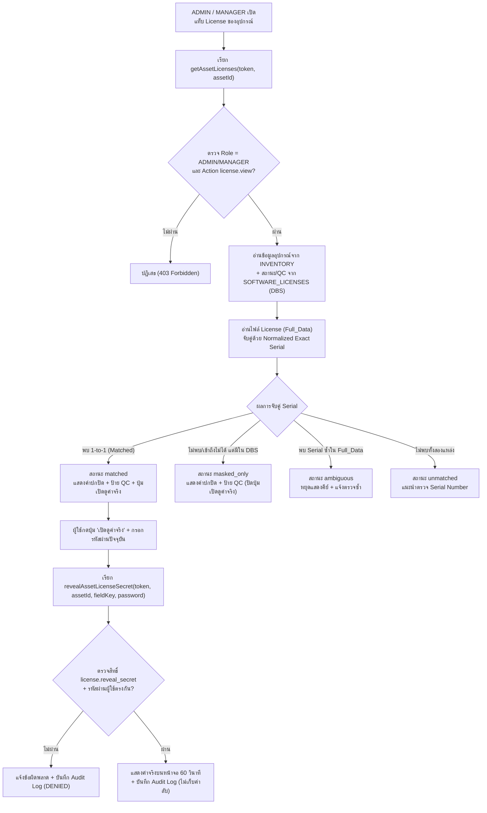
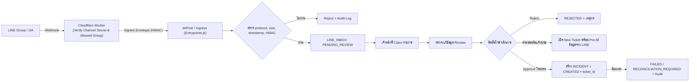
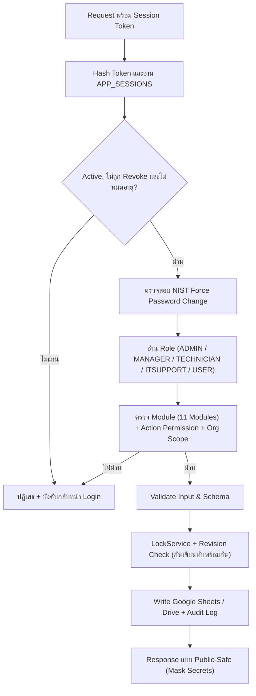
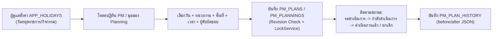

# แผนผัง Workflow ของ IT Service Desk (`V1.1.69`)

เอกสารนี้รวบรวมแผนผัง Workflow หลักทั้ง 7 กระบวนการในระบบ Web App, LINE Gateway, Software License, แผน PM และการ Release

## 1. Ticket Lifecycle และใบงาน CM-Form_69

ทุก transition ตรวจ session, permission และสถานะปัจจุบันฝั่ง server แล้วบันทึก `INCIDENT`, `INCIDENT_META` และ `INCIDENT_EVENTS` ตามหน้าที่ เมื่อเข้าสู่ขั้น `รอยืนยันผล` หรือ `ปิดงาน` ระบบจะรองรับการกรอกข้อมูล `TICKET_SERVICE_REPORT` (เสร็จสิ้นเรียบร้อย / ส่งซ่อม / สำรองอุปกรณ์ / เปลี่ยนอุปกรณ์ พร้อมเลือกอุปกรณ์จากทะเบียน Inventory) และพิมพ์ใบงาน A4 (`CM-Form_69`)

## 2. ครุภัณฑ์ การสำรวจ และการกำหนดรหัสต่อเนื่อง (`INV-TOR70-xxxx`)

ข้อมูลแต่ละแท็บแยกขอบเขตการบันทึกและล้าง cache ของแท็บ `License` อัตโนมัติเมื่อบันทึกข้อมูลทั่วไปหรือคุณลักษณะ เพื่อลดการเขียนทับข้อมูลที่ไม่ได้แก้

## 3. Software License Lookup & Secret Reveal Workflow (`V1.1.69`)

## 4. LINE Inbox และ Bridge เข้าสู่ฟอร์มแจ้งซ่อม (`V1.1.63`+)

## 5. Authentication, Permission และ Concurrency Flow

> UI ใช้ permission เพื่อซ่อน/แสดงปุ่มและเมนู แต่ **Server Permission ใน `Server.js` เป็นแหล่งตัดสินสิทธิ์จริงเสมอ**

## 6. แผน PM และปฏิทิน (`PM_PLANS` & `PM_PLANNINGS`)

## 7. Development, Clasp Push & Production Release Workflow

```mermaid
flowchart LR
  A["ยืนยัน Local / Git / Script ID / DB / Deployment ID"] --> B["สำรอง source ลง .pull-backups/ + สำรอง DB"]
  B --> C["clasp pull & ตรวจ diff"]
  C --> D["แก้ไข source + อัปเดต patch version"]
  D --> E["ตรวจ node --check + UI script + unit tests + git diff --check"]
  E --> F["git commit (แยก feat/fix กับ docs)"]
  F --> G["git push origin main"]
  G --> H{"ได้รับอนุมัติ Deploy ขึ้น Production?"}
  H -- "ยัง" --> I["หยุดที่ source พร้อมรายงานผล"]
  H -- "ได้รับอนุมัติ" --> J["clasp push --force"]
  J --> K["clasp version (สร้างเลข version ใหม่)"]
  K --> L["clasp deploy --deploymentId AKfycbxPnpvvQqm... -V N"]
  L --> M["ตรวจ HTTP 200 /exec + Smoke Test + Executions Log"]
  M --> N["บันทึก Release & Rollback Point"]
```

กฎสำคัญ:

- `clasp pull` ต้องสำรอง source ก่อนเสมอ
- GitHub และ Apps Script เป็นคนละขั้นตอน; `git push origin main` ไม่ได้เปลี่ยน Production Web App จนกว่าจะ `clasp push` และ `clasp deploy`
- ห้าม `clasp deploy` โดยไม่ระบุ `--deploymentId` เพื่อรักษา `/exec` URL เดิม
- หาก validation หรือ unit test ไม่ผ่าน ห้าม push/deploy
- Rollback source ด้วย commit ใหม่ และ rollback runtime ด้วยการย้าย deployment ID เดิมกลับไปยัง Apps Script version ก่อนหน้า
